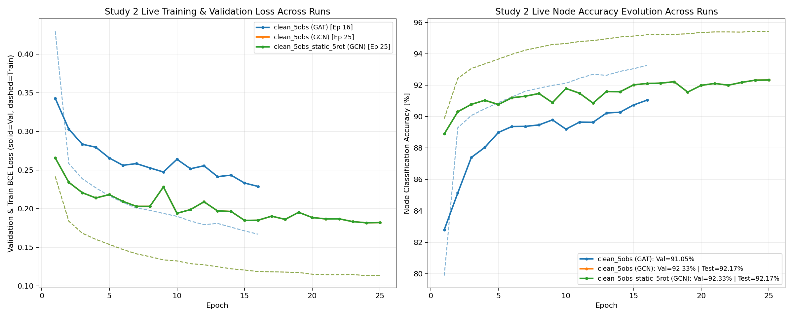

# Live Pipeline Status on Jed

```text
[2026-11-14 14:05:01] Study 2 Pipeline Status on Jed
- Step 1 (Plummer ICs): 81 / 81 ready
- Step 2 (SWIFT Runs): 81 / 81 completed (101 snapshots)
- Step 3 (Observables): Labels=81/81 | Clean=81/81 | GaiaNoisy=81/81
- Step 4 (5D Graphs): Clean=81/81 | GaiaNoisy=81/81
- Step 5/6 Live GNN Training Progress:
  * clean_5obs/training_metrics_gat_clean.log: Ep 045 | Train 0.1338 (94.72%) | Val 0.2092 (91.96%, Best=91.99%) | Test=91.43%
  * clean_5obs/training_metrics_gcn_clean.log: Ep 025 | Train 0.1136 (95.42%) | Val 0.1820 (92.33%, Best=92.33%) | Test=92.17%
  * legacy/clean_5obs_static_5rot/training_metrics_gcn_clean.log: Ep 025 | Train 0.1136 (95.42%) | Val 0.1820 (92.33%, Best=92.33%) | Test=92.17%
  * noisy_5obs/training_metrics_gat_noisy.log: Ep 016 | Train 0.2741 (87.81%) | Val 0.4213 (81.25%, Best=81.76%) | Test=In progress

SLURM Queue:
JOBID  PARTITION                   NAME   ST       TIME  NODES NODELIST(REASON)
      41185012   academic  Study2V2_Step6_Best4D   PD       0:00      2 (Dependency)
      41185011   academic Study2V2_Step5_Train5D   PD       0:00      2 (Dependency)
      41146836   academic Study2_Step7_GCNStocha   PD       0:00      2 (Dependency)
41146835_[0-4%   academic      Study2_Step6_4Obs   PD       0:00      2 (Dependency)
      41185010   academic Study2V2_Step4_BuildGr   PD       0:00      1 (Dependency)
41185009_[0-80   academic Study2V2_Step3_Extract   PD       0:00      1 (Dependency)
      41146834   academic   Study2_Step5_Train81    R 1-23:20:43      2 jst[317,320]
```

## Live Neural Network Training Metrics

| Experiment | Architecture | Latest Epoch | Train Loss | Train Acc | Val Loss | Val Acc | Best Val Acc | Test Acc | Test F1 |
| :--- | :---: | :---: | :---: | :---: | :---: | :---: | :---: | :---: | :---: |
| `clean_5obs` | **GAT** | 45 | 0.1338 | 94.72% | 0.2092 | 91.96% | **91.99%** | **91.43%** | 0.8807 |
| `clean_5obs` | **GCN** | 25 | 0.1136 | 95.42% | 0.1820 | 92.33% | **92.33%** | **92.17%** | 0.8886 |
| `clean_5obs_static_5rot` | **GCN** | 25 | 0.1136 | 95.42% | 0.1820 | 92.33% | **92.33%** | **92.17%** | 0.8886 |
| `noisy_5obs` | **GAT** | 16 | 0.2741 | 87.81% | 0.4213 | 81.25% | **81.76%** | **In progress** | - |

## Real-Time GNN Learning Curves (Loss & Accuracy Evolution)


