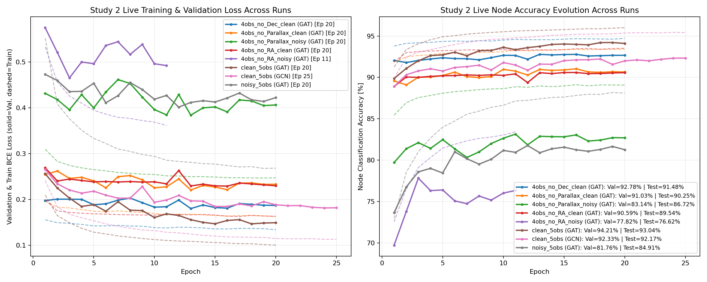
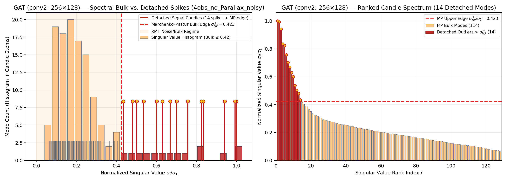
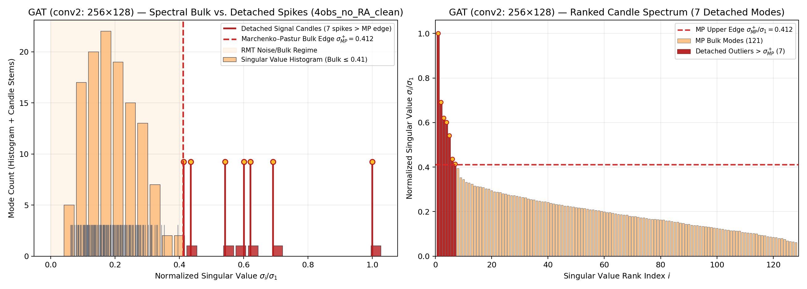
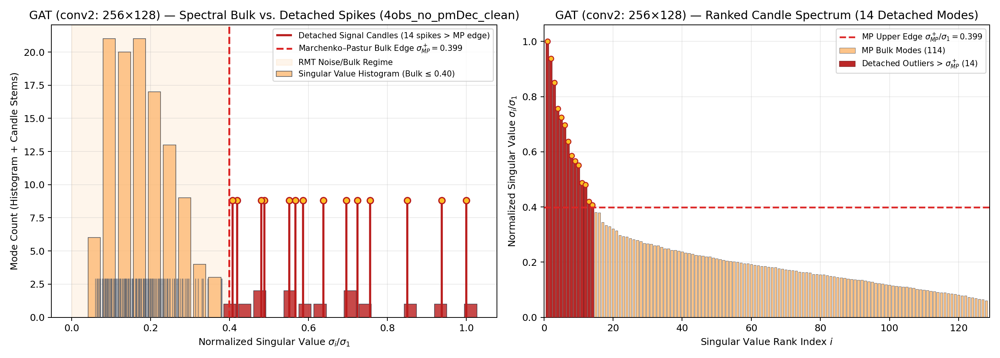
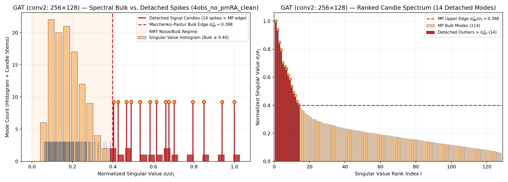

# Live Pipeline Status on Jed

```text
[2026-11-21 14:08:23] Study 2 Pipeline Status on Jed
- Base SWIFT N-body (reused by V1 & V2): ICs=81/81 | SWIFT=81/81 (101 snapshots)
- Study 2 V1 (Completed): Obs=81/81 | 5D Graphs=81/81 | Best 5D Clean GAT=93.04% | Best 4D Noisy=4obs_no_Parallax (86.72%, F1=0.8281)
- Study 2 V2 (Active Gaia DR3): Obs=81/81 | Sky-kNN Clean=81/81 | Sky-kNN Noisy=81/81 | Inference CSVs=0
- Active V2 / In-Flight Training:
  * [IN FLIGHT] v2/clean_5obs (GAT_V2): Ep 001 (Running)
- Saved Model Checkpoints (.pth): 12 mirrored in weights/

SLURM Queue:
JOBID  PARTITION                   NAME   ST       TIME  NODES NODELIST(REASON)
      41910484   academic Study2V2_Step7_TrainGC   PD       0:00      2 (Dependency)
      41910483   academic  Study2V2_Step6_Best4D   PD       0:00      2 (Dependency)
      41910482   academic Study2V2_Step5_Train5D    R       4:18      2 jst[049,051]
```

## 1. Study 2 V2 — Real *Gaia* DR3 Domain Adaptation (Active Pipeline)

- **Observables & MW Contaminants** (`/scratch/cozma/study2_v2/obs_unbiased`): **81 / 81** ICs
- **2D-Sky $k=32$ Clean Graphs** (`/scratch/cozma/study2_v2/graphs_clean`): **81 / 81** ICs
- **2D-Sky $k=32$ Noisy Graphs** (`/scratch/cozma/study2_v2/graphs_noisy`): **81 / 81** ICs
- **Selected Best-4D Subset** (`study2_v2/best_4d_config.json`): `4obs_no_Parallax` (`RA, Dec, pmRA, pmDec`, indices `0,1,3,4`)
- ***Gaia* DR3 Inference CSVs** (`GNN-jed/trained_models/study2_v2/inference/`): **0** file(s)

| V2 Experiment | Architecture | Epoch | TrLoss | TrAcc | VaLoss | VaAcc | BoundF1 | PE_Rec | CoreFNR | FieldFPR | Test Acc | Test MacroF1 |
| :--- | :---: | :---: | :---: | :---: | :---: | :---: | :---: | :---: | :---: | :---: | :---: | :---: |
| `v2/clean_5obs` | **GAT_V2 (In Flight)** | Ep 01 (Running) | - | - | - | - | - | - | - | - | **In progress** | - |

## 2. Study 2 V1 — Canonical Benchmarks & Clean 4D Ablations (Completed)

| Experiment | Architecture | Latest Epoch | Train Loss | Train Acc | Val Loss | Val Acc | Best Val Acc | Core FNR | Test Acc | Test F1 |
| :--- | :---: | :---: | :---: | :---: | :---: | :---: | :---: | :---: | :---: | :---: |
| `clean_5obs` | **GAT** | 20 | 0.1006 | 96.00% | 0.1495 | 94.10% | **94.21%** | 6.49% (val: 6.60%) | **93.04%** | 0.9035 |
| `clean_5obs` | **GCN** | 25 | 0.1136 | 95.42% | 0.1820 | 92.33% | **92.33%** | - | **92.17%** | 0.8886 |
| `noisy_5obs` | **GAT** | 20 | 0.2683 | 88.10% | 0.4221 | 81.26% | **81.76%** | 19.52% (val: 14.33%) | **84.91%** | 0.7879 |
| `4obs_no_Parallax_noisy` *(V2 Best-4D)* | **GAT** | 20 | 0.2474 | 89.07% | 0.4061 | 82.69% | **83.14%** | 8.14% (val: 7.78%) | **86.72%** | 0.8281 |
| `4obs_no_pmRA_clean` | **GAT** | 20 | 0.1221 | 95.17% | 0.1851 | 92.72% | **92.86%** | 7.20% (val: 6.92%) | **92.25%** | 0.8929 |
| `4obs_no_pmDec_clean` | **GAT** | 20 | 0.1305 | 94.83% | 0.1981 | 91.87% | **91.97%** | 6.67% (val: 7.19%) | **92.02%** | 0.8907 |
| `4obs_no_Dec_clean` | **GAT** | 20 | 0.1343 | 94.71% | 0.1872 | 92.67% | **92.78%** | 7.90% (val: 5.48%) | **91.48%** | 0.8828 |
| `4obs_no_Parallax_clean` | **GAT** | 20 | 0.1635 | 93.41% | 0.2332 | 90.65% | **91.03%** | 7.27% (val: 5.63%) | **90.25%** | 0.8689 |
| `4obs_no_RA_clean` | **GAT** | 20 | 0.1632 | 93.52% | 0.2301 | 90.57% | **90.59%** | 12.00% (val: 8.41%) | **89.54%** | 0.8543 |

## 3. Real-Time GNN Learning Curves (V2 + Canonical V1)



## 4. Key RMT Singular Value Candle Spectra (Canonical 5D & V2)

### `clean_5obs`


### `noisy_5obs`


---

## 5. Reference Archives (Collapsed)

<details>
<summary>Superseded V1 4D Noisy Ablations (not used in V2; <code>4obs_no_Dec_noisy</code> skipped)</summary>

| Experiment | Architecture | Latest Epoch | Train Loss | Train Acc | Val Loss | Val Acc | Best Val Acc | Core FNR | Test Acc | Test F1 |
| :--- | :---: | :---: | :---: | :---: | :---: | :---: | :---: | :---: | :---: | :---: |
| `4obs_no_pmDec_noisy` | **GAT** | 19 | 0.2656 | 88.05% | 0.3954 | 81.74% | **82.09%** | 23.23% (val: 12.74%) | **84.15%** | 0.7714 |
| `4obs_no_pmRA_noisy` | **GAT** | 19 | 0.2670 | 87.96% | 0.4005 | 81.56% | **81.92%** | 23.21% (val: 13.75%) | **84.06%** | 0.7705 |
| `4obs_no_RA_noisy` | **GAT** | 11 | 0.3614 | 83.41% | 0.4919 | 76.33% | **77.82%** | 44.35% (val: 10.87%) | **76.62%** | 0.6238 |

</details>

<details>
<summary>Saved Model Weights (12 <code>.pth</code> checkpoints)</summary>

| Checkpoint | Size | Experiment Path | Central Archive Mirror |
| :--- | :---: | :--- | :--- |
| `best_gat_4obs_no_Dec_clean.pth` | 358.0 KB | `GNN-jed/trained_models/study2/4obs_no_Dec_clean/best_gat_4obs_no_Dec_clean.pth` | `GNN-jed/trained_models/study2/weights/best_gat_4obs_no_Dec_clean.pth` |
| `best_gat_4obs_no_Parallax_clean.pth` | 358.1 KB | `GNN-jed/trained_models/study2/4obs_no_Parallax_clean/best_gat_4obs_no_Parallax_clean.pth` | `GNN-jed/trained_models/study2/weights/best_gat_4obs_no_Parallax_clean.pth` |
| `best_gat_4obs_no_Parallax_noisy.pth` | 358.1 KB | `GNN-jed/trained_models/study2/4obs_no_Parallax_noisy/best_gat_4obs_no_Parallax_noisy.pth` | `GNN-jed/trained_models/study2/weights/best_gat_4obs_no_Parallax_noisy.pth` |
| `best_gat_4obs_no_RA_clean.pth` | 357.9 KB | `GNN-jed/trained_models/study2/4obs_no_RA_clean/best_gat_4obs_no_RA_clean.pth` | `GNN-jed/trained_models/study2/weights/best_gat_4obs_no_RA_clean.pth` |
| `best_gat_4obs_no_RA_noisy.pth` | 357.9 KB | `GNN-jed/trained_models/study2/4obs_no_RA_noisy/best_gat_4obs_no_RA_noisy.pth` | `GNN-jed/trained_models/study2/weights/best_gat_4obs_no_RA_noisy.pth` |
| `best_gat_4obs_no_pmDec_clean.pth` | 358.0 KB | `GNN-jed/trained_models/study2/4obs_no_pmDec_clean/best_gat_4obs_no_pmDec_clean.pth` | `GNN-jed/trained_models/study2/weights/best_gat_4obs_no_pmDec_clean.pth` |
| `best_gat_4obs_no_pmDec_noisy.pth` | 358.0 KB | `GNN-jed/trained_models/study2/4obs_no_pmDec_noisy/best_gat_4obs_no_pmDec_noisy.pth` | `GNN-jed/trained_models/study2/weights/best_gat_4obs_no_pmDec_noisy.pth` |
| `best_gat_4obs_no_pmRA_clean.pth` | 358.0 KB | `GNN-jed/trained_models/study2/4obs_no_pmRA_clean/best_gat_4obs_no_pmRA_clean.pth` | `GNN-jed/trained_models/study2/weights/best_gat_4obs_no_pmRA_clean.pth` |
| `best_gat_4obs_no_pmRA_noisy.pth` | 358.0 KB | `GNN-jed/trained_models/study2/4obs_no_pmRA_noisy/best_gat_4obs_no_pmRA_noisy.pth` | `GNN-jed/trained_models/study2/weights/best_gat_4obs_no_pmRA_noisy.pth` |
| `best_gat_clean.pth` | 361.2 KB | `GNN-jed/trained_models/study2/clean_5obs/best_gat_clean.pth` | `GNN-jed/trained_models/study2/weights/best_gat_clean.pth` |
| `best_gcn_clean.pth` | 120.0 KB | `GNN-jed/trained_models/study2/clean_5obs/best_gcn_clean.pth` | `GNN-jed/trained_models/study2/weights/best_gcn_clean.pth` |
| `best_gat_noisy.pth` | 361.2 KB | `GNN-jed/trained_models/study2/noisy_5obs/best_gat_noisy.pth` | `GNN-jed/trained_models/study2/weights/best_gat_noisy.pth` |

</details>

<details>
<summary>V1 4D Ablation RMT Candle Spectra (6 figures)</summary>

### `4obs_no_Dec_clean`


### `4obs_no_Parallax_clean`


### `4obs_no_Parallax_noisy`


### `4obs_no_RA_clean`


### `4obs_no_pmDec_clean`


### `4obs_no_pmRA_clean`


</details>
