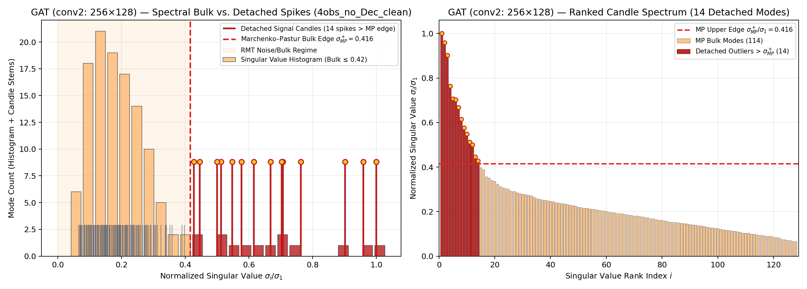
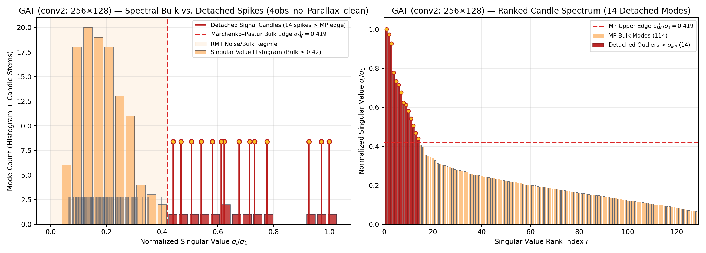
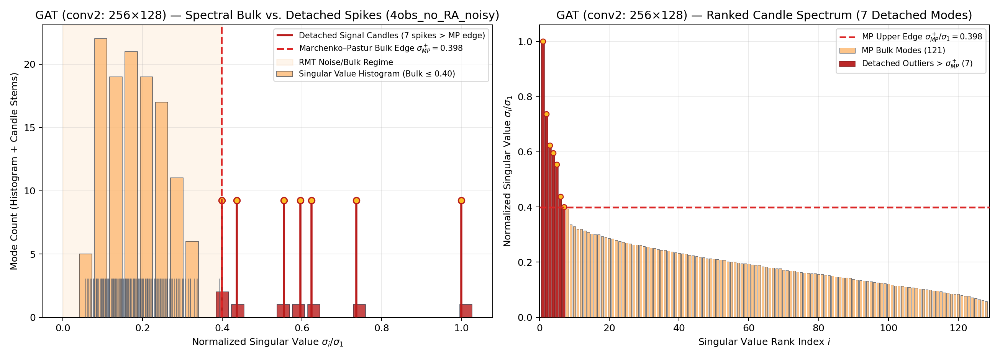
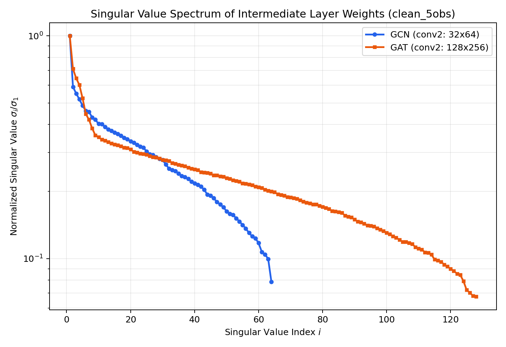
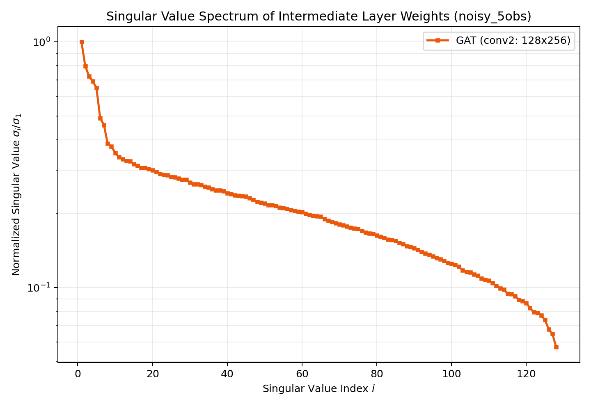

# Live Pipeline Status on Jed

```text
[2026-11-18 03:24:38] Study 2 Pipeline Status on Jed
- Step 1 (Plummer ICs): 81 / 81 ready
- Step 2 (SWIFT Runs): 81 / 81 completed (101 snapshots)
- Step 3 (Observables): Labels=81/81 | Clean=81/81 | GaiaNoisy=81/81
- Step 4 (5D Graphs): Clean=81/81 | GaiaNoisy=81/81
- Step 5/6 Live GNN Training Progress:
  * 4obs_no_Dec_clean/training_metrics_gat_4obs_no_Dec_clean.log: Ep 020 | Train 0.1343 (94.71%) | Val 0.1872 (92.67%, Best=92.78%) | CoreFNR: 6.17% (min=5.48%) | Test=91.48%
  * 4obs_no_Parallax_clean/training_metrics_gat_4obs_no_Parallax_clean.log: Ep 020 | Train 0.1635 (93.41%) | Val 0.2332 (90.65%, Best=91.03%) | CoreFNR: 6.15% (min=5.63%) | Test=90.25%
  * 4obs_no_Parallax_noisy/training_metrics_gat_4obs_no_Parallax_noisy.log: Ep 002 | Train 0.2831 (86.94%) | Val 0.4178 (81.37%, Best=81.37%) | CoreFNR: 9.94% (min=9.94%) | Test=In progress
  * 4obs_no_RA_clean/training_metrics_gat_4obs_no_RA_clean.log: Ep 020 | Train 0.1632 (93.52%) | Val 0.2301 (90.57%, Best=90.59%) | CoreFNR: 11.50% (min=8.41%) | Test=89.54%
  * 4obs_no_RA_noisy/training_metrics_gat_4obs_no_RA_noisy.log: Ep 011 | Train 0.3614 (83.41%) | Val 0.4919 (76.33%, Best=77.82%) | CoreFNR: 36.76% (min=10.87%) | Test=76.62%
  * clean_5obs/training_metrics_gat_clean.log: Ep 020 | Train 0.1006 (96.00%) | Val 0.1495 (94.10%, Best=94.21%) | CoreFNR: 6.64% (min=6.60%) | Test=93.04%
  * clean_5obs/training_metrics_gcn_clean.log: Ep 025 | Train 0.1136 (95.42%) | Val 0.1820 (92.33%, Best=92.33%) | Test=92.17%
  * noisy_5obs/training_metrics_gat_noisy.log: Ep 020 | Train 0.2683 (88.10%) | Val 0.4221 (81.26%, Best=81.76%) | CoreFNR: 23.60% (min=14.33%) | Test=84.91%
  * [IN FLIGHT] 4obs_no_Parallax_noisy (GAT): Ep 002 | Batch 0103/0103 (100.0%) | Batch Loss 0.2179 | LR: 4.88e-04 | RAM: 91.1G
- Saved Model Checkpoints (.pth): 8 mirrored in GNN-jed/trained_models/study2/weights/

SLURM Queue:
JOBID  PARTITION                   NAME   ST       TIME  NODES NODELIST(REASON)
41146835_[3-4%   academic      Study2_Step6_4Obs   PD       0:00      2 (JobArrayTaskLimit)
      41185012   academic  Study2V2_Step6_Best4D   PD       0:00      2 (Dependency)
      41185011   academic Study2V2_Step5_Train5D   PD       0:00      2 (Dependency)
      41185010   academic Study2V2_Step4_BuildGr   PD       0:00      1 (Dependency)
41185009_[0-80   academic Study2V2_Step3_Extract   PD       0:00      1 (Dependency)
      41146836   academic Study2_Step7_GCNStocha   PD       0:00      2 (Dependency)
    41146835_2   academic      Study2_Step6_4Obs    R   15:46:20      2 jst[282,294]
```

## Live Neural Network Training Metrics

| Experiment | Architecture | Latest Epoch | Train Loss | Train Acc | Val Loss | Val Acc | Best Val Acc | Core FNR | Test Acc | Test F1 |
| :--- | :---: | :---: | :---: | :---: | :---: | :---: | :---: | :---: | :---: | :---: |
| `4obs_no_Dec_clean` | **GAT** | 20 | 0.1343 | 94.71% | 0.1872 | 92.67% | **92.78%** | 7.90% (val: 5.48%) | **91.48%** | 0.8828 |
| `4obs_no_Parallax_clean` | **GAT** | 20 | 0.1635 | 93.41% | 0.2332 | 90.65% | **91.03%** | 7.27% (val: 5.63%) | **90.25%** | 0.8689 |
| `4obs_no_Parallax_noisy` | **GAT** | 2 | 0.2831 | 86.94% | 0.4178 | 81.37% | **81.37%** | 9.94% (val min) | **In progress** | - |
| `4obs_no_RA_clean` | **GAT** | 20 | 0.1632 | 93.52% | 0.2301 | 90.57% | **90.59%** | 12.00% (val: 8.41%) | **89.54%** | 0.8543 |
| `4obs_no_RA_noisy` | **GAT** | 11 | 0.3614 | 83.41% | 0.4919 | 76.33% | **77.82%** | 44.35% (val: 10.87%) | **76.62%** | 0.6238 |
| `clean_5obs` | **GAT** | 20 | 0.1006 | 96.00% | 0.1495 | 94.10% | **94.21%** | 6.49% (val: 6.60%) | **93.04%** | 0.9035 |
| `clean_5obs` | **GCN** | 25 | 0.1136 | 95.42% | 0.1820 | 92.33% | **92.33%** | - | **92.17%** | 0.8886 |
| `noisy_5obs` | **GAT** | 20 | 0.2683 | 88.10% | 0.4221 | 81.26% | **81.76%** | 19.52% (val: 14.33%) | **84.91%** | 0.7879 |
| `4obs_no_Parallax_noisy` | **GAT (In Flight)** | Ep 02 (100%) | 0.2179 | - | - | - | - | - | **In progress** | - |

## Saved Model Weights (`.pth` Checkpoints)

| Checkpoint | Size | Experiment Path | Central Archive Mirror |
| :--- | :---: | :--- | :--- |
| `best_gat_4obs_no_Dec_clean.pth` | 358.0 KB | `GNN-jed/trained_models/study2/4obs_no_Dec_clean/best_gat_4obs_no_Dec_clean.pth` | `GNN-jed/trained_models/study2/weights/best_gat_4obs_no_Dec_clean.pth` |
| `best_gat_4obs_no_Parallax_clean.pth` | 358.1 KB | `GNN-jed/trained_models/study2/4obs_no_Parallax_clean/best_gat_4obs_no_Parallax_clean.pth` | `GNN-jed/trained_models/study2/weights/best_gat_4obs_no_Parallax_clean.pth` |
| `best_gat_4obs_no_Parallax_noisy.pth` | 358.1 KB | `GNN-jed/trained_models/study2/4obs_no_Parallax_noisy/best_gat_4obs_no_Parallax_noisy.pth` | `GNN-jed/trained_models/study2/weights/best_gat_4obs_no_Parallax_noisy.pth` |
| `best_gat_4obs_no_RA_clean.pth` | 357.9 KB | `GNN-jed/trained_models/study2/4obs_no_RA_clean/best_gat_4obs_no_RA_clean.pth` | `GNN-jed/trained_models/study2/weights/best_gat_4obs_no_RA_clean.pth` |
| `best_gat_4obs_no_RA_noisy.pth` | 357.9 KB | `GNN-jed/trained_models/study2/4obs_no_RA_noisy/best_gat_4obs_no_RA_noisy.pth` | `GNN-jed/trained_models/study2/weights/best_gat_4obs_no_RA_noisy.pth` |
| `best_gat_clean.pth` | 361.2 KB | `GNN-jed/trained_models/study2/clean_5obs/best_gat_clean.pth` | `GNN-jed/trained_models/study2/weights/best_gat_clean.pth` |
| `best_gcn_clean.pth` | 120.0 KB | `GNN-jed/trained_models/study2/clean_5obs/best_gcn_clean.pth` | `GNN-jed/trained_models/study2/weights/best_gcn_clean.pth` |
| `best_gat_noisy.pth` | 361.2 KB | `GNN-jed/trained_models/study2/noisy_5obs/best_gat_noisy.pth` | `GNN-jed/trained_models/study2/weights/best_gat_noisy.pth` |

## Real-Time GNN Learning Curves (Loss & Accuracy Evolution)


## RMT Singular Value Candle Spectra (Marchenko-Pastur Bulk vs Detached Signal)

### `4obs_no_Dec_clean`


### `4obs_no_Parallax_clean`


### `4obs_no_Parallax_noisy`


### `4obs_no_RA_clean`


### `4obs_no_RA_noisy`


### `clean_5obs`


### `noisy_5obs`


