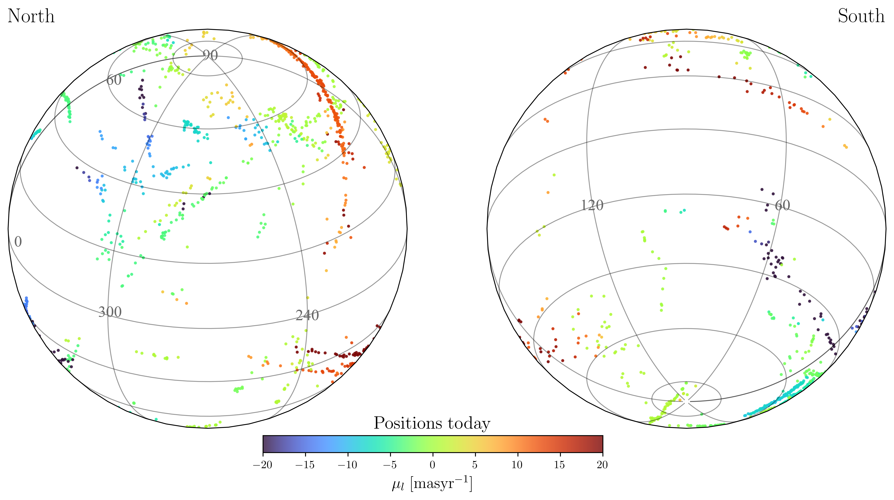
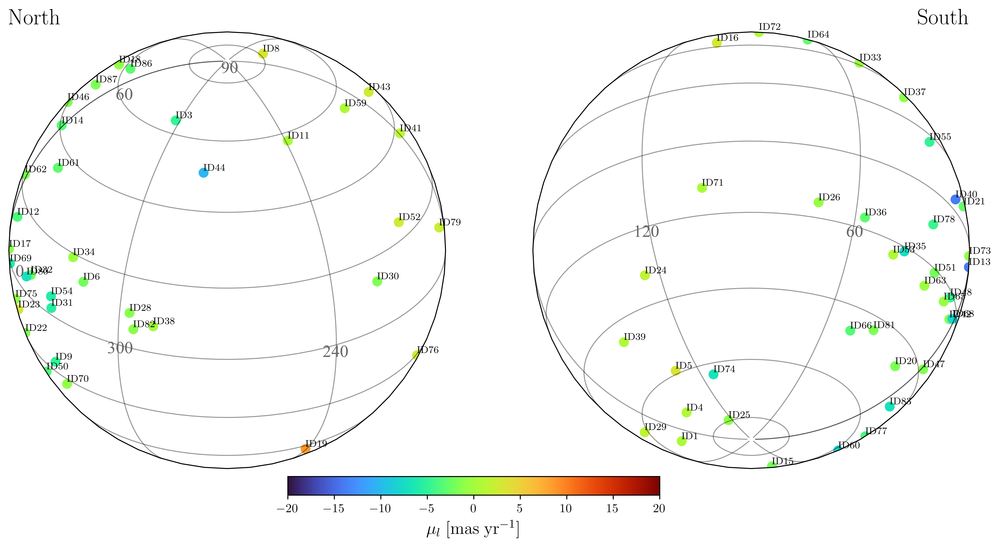
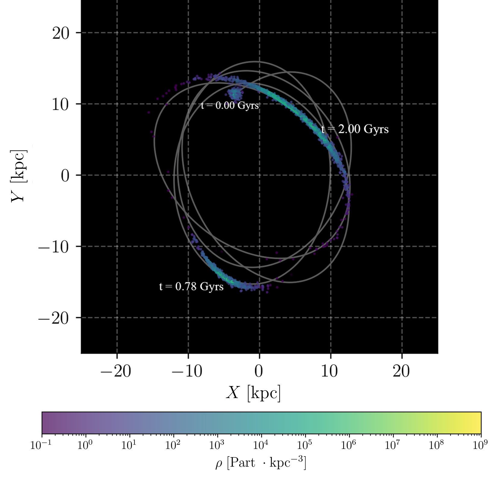
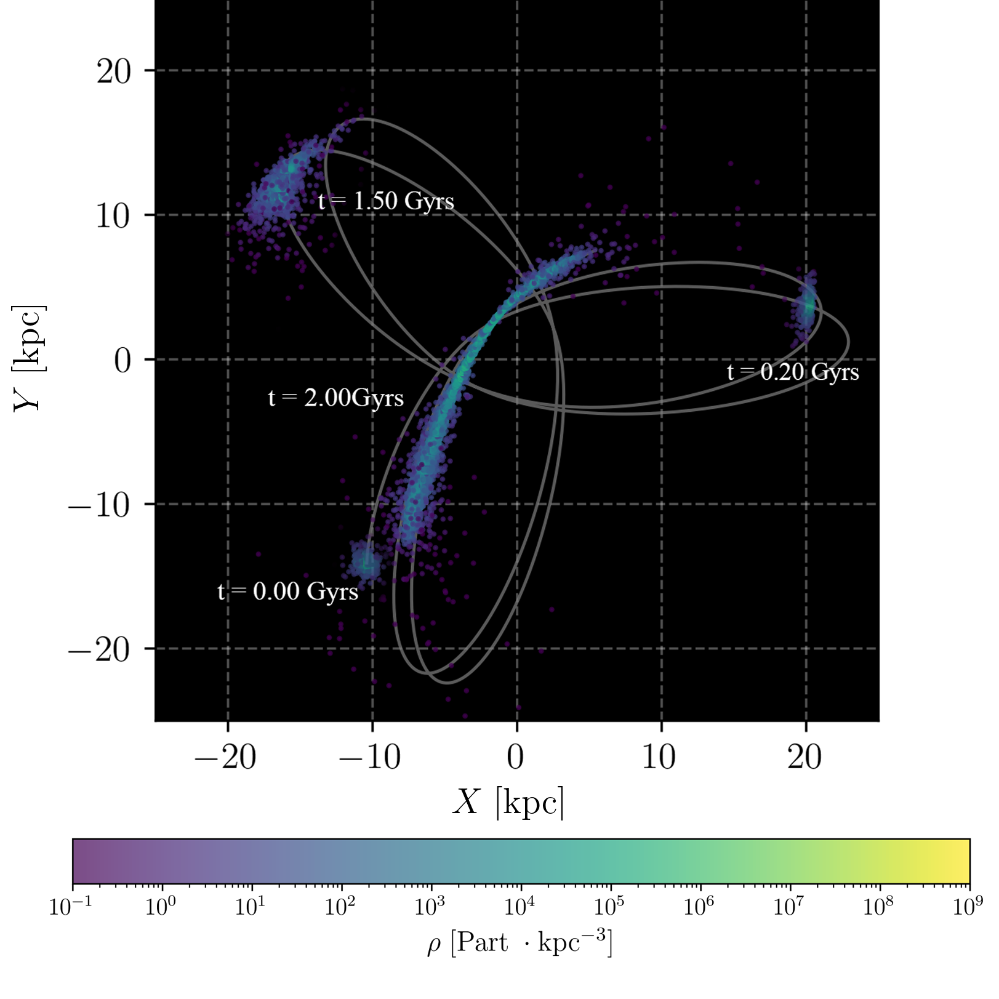
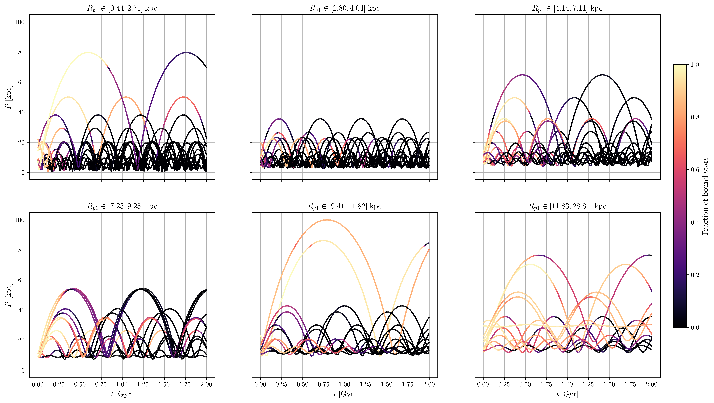
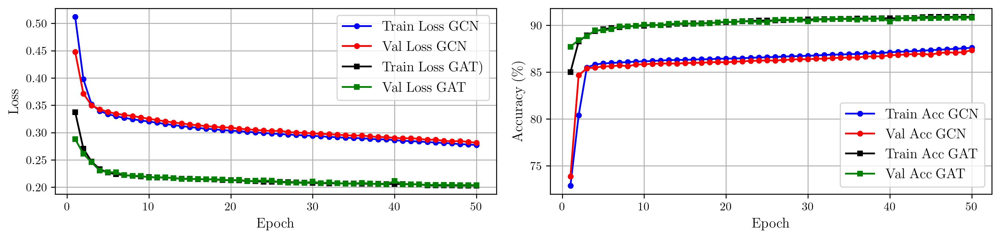
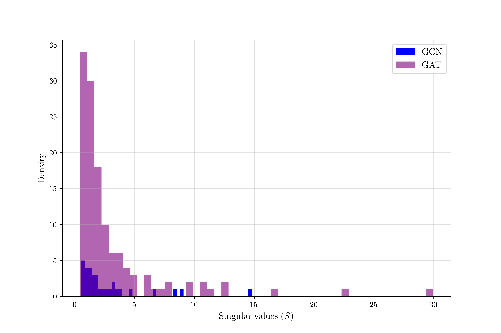
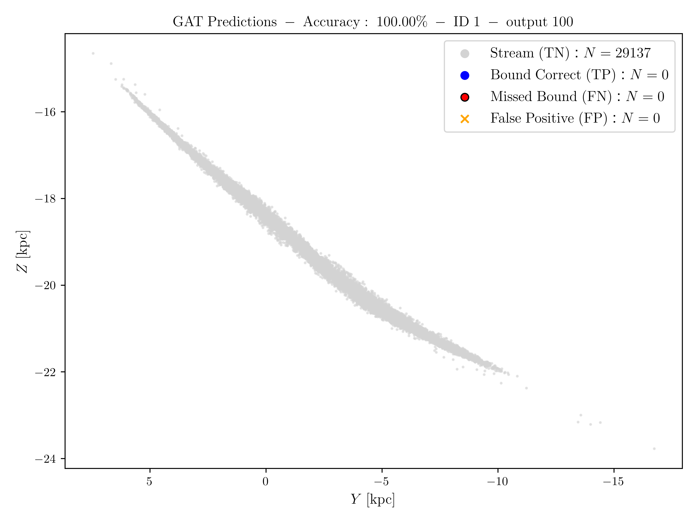
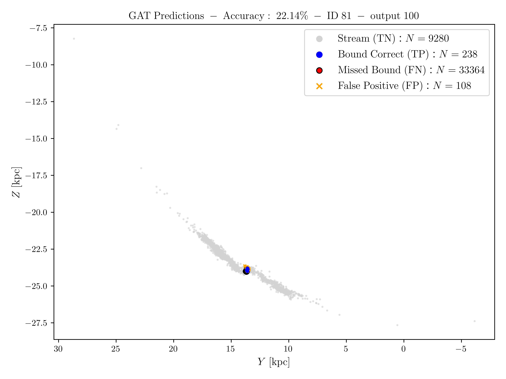
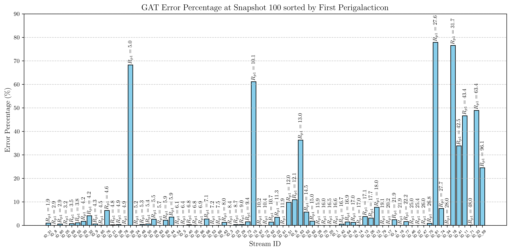

# Identifying Potential Escapers with Graph Neural Networks: Recovering Cluster Dynamics from Partial Kinematics

**Author:** Adrian Cozma ([@adricozma](https://github.com/adricozma))  
**Affiliation:** Laboratory of Astrophysics (LASTRO), École Polytechnique Fédérale de Lausanne (EPFL)  
**Supervisors:** Prof. Yves Revaz, Dr. Srikanth Nagesh  

---

## Overview

As globular clusters orbit the Milky Way, gravitational tidal forces strip stars from their outer envelopes, forming elongated **stellar streams**. Determining whether an observed star remains gravitationally bound to the progenitor core, is a **potential escaper** trapped inside the Jacobi surface with excess energy, or has already escaped into the unbound tidal tails formally requires full 6D phase-space coordinates $(x, y, z, v_x, v_y, v_z)$ and explicit knowledge of the host galactic potential.

In observational surveys such as *Gaia*, however, radial velocities $(v_{\mathrm{los}})$ are missing for the vast majority of faint stars $(G \gt 16)$, leaving only 5D astrometric measurements: sky positions $(\alpha, \delta)$, parallax $(\varpi)$, and proper motions $(\mu_{\alpha^*}, \mu_\delta)$.

This repository provides a complete numerical and deep-learning pipeline that:
1. Reconstructs realistic progenitor initial conditions via backward orbit integration of observed Milky Way stellar streams from the *Gaia* DR3 atlas (Ibata et al. 2024) inside a realistic three-component Milky Way potential (`MWPotential2014`, Bovy 2015).
2. Evolves 81 self-consistent *N*-body Plummer globular clusters forward in time for $2.0\text{ Gyr}$ using the cosmological/astrophysical code `SWIFT` (Schaller et al. 2024) on the EPFL HPC cluster **Jed** (and 75 clusters in Study 1).
3. Computes exact physical boundness and potential escaper labels from 3D Jacobi energies and tidal radii following Küpper et al. (2010a,b), using a 3D *k*-nearest-neighbor local density estimator (Casertano & Hut 1985) and iterative shrinking spheres to track the surviving core accurately even in heavily stripped streams.
4. Projects the simulations into synthetic 5D *Gaia*-like astrometric observables with data augmentation over random observer orientations and physical-scale standardization.
5. Trains **Residual Graph Convolutional Networks (GCN)** and **Multi-Head Residual Graph Attention Networks (GAT)** with local phase-space relational encoding (`3d + 3` invariants) on *k*-NN graphs $(k = 20)$, using **Two-Stage Curriculum Learning** (noiseless pre-training $\to$ *Gaia* DR3 magnitude-dependent noisy fine-tuning), **subspace-aligned $5\mathrm{D} \to 4\mathrm{D}$ weight transfer** for systematic observable ablations, and multi-node distributed training with micro-batch gradient accumulation and automatic disk activation offloading.

> **Live Training Progress:**  
> Real-time training metrics and learning curve figures (`latest_live_training.png` & `live_plots_GNN_*.png`) are tracked in [**`LIVE_STATUS.md`**](LIVE_STATUS.md), and pre-trained model checkpoints (`.pth`) are indexed in [**`GNN-jed/trained_models/study2/weights/MODEL_WEIGHTS_REGISTRY.md`**](GNN-jed/trained_models/study2/weights/MODEL_WEIGHTS_REGISTRY.md).

---

## Repository Structure

The repository is organized to separate core physical/feature-engineering modules (`src/`), executable production pipelines (`scripts/`), SLURM cluster templates (`slurm/`), initial condition generation (`make_ICs/`), visualization utilities (`visualization/`), and interactive analysis notebooks (`notebooks/`):

```text
.
├── assets/
│   └── figures/                         # Figures from simulations, orbital dynamics, and GNN evaluation
├── configs/
│   ├── params.yml                       # SWIFT runtime configuration (MilkyWayPotential2014, leapfrog/gravity)
│   └── dependency_graph_0.csv           # SWIFT task-level dependency graph
├── make_ICs/
│   ├── Ibata_catalog.txt                # Gaia DR3 stellar stream catalog (Ibata et al. 2024)
│   ├── stars_6D_ibata2024.csv           # Filtered 6D stream stars used to define progenitor orbits
│   ├── select_unbiased_orbits.py        # Unbiased progenitor orbit selector (R_p >= 0.0 kpc, 81 streams)
│   ├── generate_unbiased_ics.py         # Batch virialized Plummer sphere HDF5 generator for SWIFT
│   ├── IC_plummer_swift.py              # Isotropic/anisotropic Plummer sphere HDF5 generator
│   ├── OrbitIntegration_Ibata.ipynb     # Backward orbit integration (-2 Gyr) in galpy MWPotential2014
│   ├── WorkflowIbata.ipynb              # Catalog processing and progenitor seed extraction workflow
│   ├── SWIFT_seeds.npy                  # Study 1 6D phase-space seeds at t = -2 Gyr (75 streams)
│   ├── SWIFT_seeds_unbiased.npy         # Study 2 unbiased 6D phase-space seeds at t = -2 Gyr (81 streams)
│   ├── unbiased_orbits_summary.csv      # Orbital parameters (R_p, R_a, eccentricity) across streams
│   ├── orbits/                          # Integrated 2 Gyr orbital trajectories (Study 1)
│   └── orbits_unbiased/                 # Integrated 2 Gyr unbiased orbital trajectories (Study 2)
├── src/
│   ├── bound_labels.py                  # 3D k-NN density + shrinking-sphere centering & exact Jacobi/Roche solver
│   ├── observables_matrix.py            # Haar-uniform SO(3) rotations, ICRS projection, Gaia DR3 noise & scaling
│   ├── gnn_models.py                    # Local phase-space relational encoder, Residual GCN & Multi-Head GAT
│   ├── oom_Pin_and_offload.py           # Distributed DDP initializer & cgroup-aware disk activation offloader
│   └── Stellar_objects/                 # Utilities for King/Plummer cluster profiles and LOS dispersion
├── scripts/
│   ├── extract_observables.py           # Parallel extraction of bound labels + Clean & Gaia DR3 Noisy observables
│   ├── build_graph_dataset.py           # Parallel cKDTree k-NN graph builder (5D full & 4D ablation subsets)
│   ├── distributed_trainer.py           # Unified DDP, micro-batch gradient accumulation & checkpoint engine
│   ├── train_gcn.py                     # 3-layer Residual GCN classifier training CLI (clean_5obs baseline)
│   ├── train_gat.py                     # 3-layer Multi-Head Residual GAT training & curriculum fine-tuning CLI
│   ├── generate_study2_figures.py       # Automated evaluation & publication figure generator (.png & .html)
│   ├── live_plot_utils.py               # Real-time learning curve plotter from training logs
│   └── live_monitor.py                  # Automated training telemetry and status updater
├── slurm/
│   ├── step1_orbits_and_ics.sh          # Step 1: Orbit integration & Plummer HDF5 initial conditions
│   ├── step2_run_swift_array.sh         # Step 2: SWIFT N-body simulation job array
│   ├── step3_extract_observables.sh     # Step 3: Bound label & Clean/Noisy observable extraction
│   ├── step4_build_graphs.sh            # Step 4: 5D k-NN PyTorch Geometric graph construction
│   ├── step5_train_curriculum_and_plot.sh # Step 5: 5-Observable Clean -> Gaia DR3 Noisy curriculum training
│   ├── step6_ablation_4obs.sh           # Step 6: 4-Observable ablation study (5D -> 4D weight transfer)
│   └── launch_full_study2_pipeline.sh   # Master SLURM pipeline launcher chaining Steps 5 and 6
├── visualization/
│   ├── plot_swift_output.py             # HDF5 snapshot loader (DMParticles coordinates, velocities, masses, time)
│   ├── visu_stream_outputs.py           # 3D Galactocentric stream rendering and projection animations
│   ├── plot_metric_live.py              # Training vs. validation loss curve plotter from training logs
│   ├── final_sims_vizu.ipynb            # All-sky orthographic (Cartopy) and depth-sorted Galactocentric plots
│   └── fraction_bound_stars.ipynb       # Bound fraction evolution vs. orbital eccentricity and perigalacticon
├── notebooks/
│   ├── labels_data_matrices.ipynb       # Interactive generation and verification of labels and observable matrices
│   ├── graph_data.ipynb                 # PyTorch Geometric k-NN graph construction from 5D observables
│   └── test-model-GCN.ipynb             # Model inference, perigalacticon error analysis, and RMT SVD diagnostics
└── GNN-jed/
    └── trained_models/
        ├── GCN-01/                      # Study 1 baseline GCN weights (best_gnn_model_01.pth) & logs
        ├── GCN-02/                      # Study 1 multi-head GAT weights (best_gnn_model_02.pth) & logs
        └── study2/                      # Study 2 curriculum & ablation logs, figures, and checkpoints
            └── weights/                 # Central archive of best_*.pth checkpoints & MODEL_WEIGHTS_REGISTRY.md
```

*Note:* Bulk `SWIFT` simulation snapshots, intermediate `.npy` observable/label arrays, and serialized `.pt` graph datasets are excluded from version control via `.gitignore` and can be generated in any user-specified local or scratch directory (`$DATA_DIR`).

---

## Physical & Methodological Pipeline

### 1. Progenitor Orbit Reconstruction & *N*-Body Simulations (`make_ICs/`, `configs/`)

Starting from the *Gaia* DR3 stellar stream catalog of Ibata et al. (2024), stars with complete 6D phase-space measurements are grouped by stream identifier (`Track`). Representative present-day stream anchors are integrated backward in time for $\Delta t = -2.0\text{ Gyr}$ using `galpy` (Bovy 2015) inside `MWPotential2014` — a three-component potential comprising a Miyamoto-Nagai disk, a power-law bulge with exponential cut-off, and an NFW dark matter halo, calibrated to $R_0 = 8.0\text{ kpc}$ and $V_c = 220\text{ km s}^{-1}$.

| Present-Day Stream Anchors $(t = 0\text{ Gyr})$ | Backward-Integrated Progenitor Seeds $(t = -2.0\text{ Gyr})$ |
| :---: | :---: |
|  |  |

At each $t = -2.0\text{ Gyr}$ seed position, an isotropic $(q = 0)$ Plummer sphere (Plummer 1911) of total mass $M = 10^4\,M_\odot$, scale radius $a = 4\text{ pc}$, and $N \in [2500, 3500]$ equal-mass particles is initialized via `make_ICs/IC_plummer_swift.py`:

$$
\rho(r) = \frac{3M}{4\pi a^3}\left(1 + \frac{r^2}{a^2}\right)^{-5/2}, \qquad \Phi(r) = -\frac{GM}{\sqrt{r^2 + a^2}}.
$$

Each cluster is evolved forward for $2.0\text{ Gyr}$ in `SWIFT` (Schaller et al. 2024) using `configs/params.yml` with 101 HDF5 snapshots per simulation $(\Delta t_{\mathrm{snap}} = 20\text{ Myr})$ and a comoving Plummer-equivalent softening length $\epsilon = 1\text{ pc}$.

| Tidal Disruption Sequence (`IC_53`, Low Perigalacticon) | Multi-Epoch Stream Formation (`IC_70`) |
| :---: | :---: |
|  |  |

---

### 2. Dynamical Boundness, Potential Escapers & Orbital Evolution (`src/bound_labels.py`)

Following Binney & Tremaine (2008) and Küpper et al. (2010a,b), a star in a cluster orbiting at galactocentric distance $R_{\mathrm{gal}}$ with instantaneous angular velocity $\mathbf{\Omega} = (\mathbf{R}_{\mathrm{gal}} \times \mathbf{V}_{\mathrm{gal}}) / R_{\mathrm{gal}}^2$ experiences an effective tidal boundary given by the King (1962) / Jacobi radius:

$$
R_J = \left(\frac{G M(\lt R_J)}{\Omega^2 - \frac{\partial^2 \Phi_{\mathrm{gal}}}{\partial R_{\mathrm{gal}}^2}}\right)^{1/3}, \qquad E_{\mathrm{crit}} = -\frac{3}{2}\frac{G M(\lt R_J)}{R_J}.
$$

Each star's specific Jacobi energy in the co-rotating frame relative to the surviving cluster core is:

$$
E_J = \frac{1}{2}\lVert\mathbf{v}_{\mathrm{rel}}\rVert^2 + \Phi_{\mathrm{cluster}}(r_{3D}) - \frac{1}{2}\left[\Omega^2 r_{3D}^2 - (\mathbf{\Omega}\cdot\mathbf{r}_{\mathrm{rel}})^2\right].
$$

To prevent extended, asymmetric tidal tails from biasing the cluster center-of-mass toward empty space between the tails, `src/bound_labels.py` locates the surviving core via a 3D *k*-nearest-neighbor local density estimator $\rho_i \propto d_{k,i}^{-3}$ (Casertano & Hut 1985) followed by an iterative shrinking-sphere refinement from $0.5\text{ kpc}$ down to $0.05\text{ kpc}$. Stars are classified into:
- **Bound Core Stars (`label = 1`):** $E_J \lt E_{\mathrm{crit}}$ and $r_{3D} \lt R_J$ (solved iteratively to convergence).
- **Potential Escapers:** $E_J \ge E_{\mathrm{crit}}$ and $r_{3D} \lt R_J$ (stars energetically unbound that remain spatially trapped inside the Jacobi surface near the $L_1 / L_2$ Lagrange points).
- **Unbound Stream Stars (`label = 0`):** Stars outside the Jacobi radius or exceeding the critical Jacobi energy.


*Evolution of the Galactocentric radius $R(t)$ over $2.0\text{ Gyr}$ across simulated clusters (75 in Study 1, expanded to 81 unbiased streams in Study 2), grouped into six panels by their first perigalacticon distance $R_{p1}$ and color-coded by the instantaneous fraction of bound stars.*

---

### 3. Synthetic 5D *Gaia* Observables & *k*-NN Graph Construction (`src/observables_matrix.py`)

For each snapshot, the 3D Galactocentric particle coordinates are rotated by $n_{\mathrm{rot}} = 5$ random 3D Euler matrices $\mathbf{R} \in \mathrm{SO}(3)$ to augment viewing angles, transformed into the heliocentric International Celestial Reference System (ICRS) via `astropy.coordinates.SkyCoord`, and restricted to the 5D astrometric feature vector:

$$
\mathbf{x}_i = \left(\Delta\alpha_i\cos\delta_c,\; \Delta\delta_i,\; \Delta\varpi_i,\; \Delta\mu_{\alpha^*,i},\; \Delta\mu_{\delta,i}\right) \in \mathbb{R}^5.
$$

In `src/observables_matrix.py`, features are centered on the robust stream median (handling the $0^\circ / 360^\circ$ Right Ascension wrap via circular trigonometry) and normalized by fixed reference physical scales (`mode="physical"`) rather than per-snapshot unit-variance Z-scores, preserving the contrast in angular and kinematic compactness between bound cores and dispersed tidal tails. A directed *k*-nearest-neighbor graph $(k = 20)$ is constructed in this 5D feature space using `torch_geometric.nn.knn_graph`.

---

### 4. Graph Neural Network Architectures, Curriculum Learning & 5D $\to$ 4D Ablation Transfer (`src/`, `scripts/`, `slurm/`)

To overcome the scale blindness of constant-degree $k$-NN graphs ($k = 20$), [`src/gnn_models.py`](src/gnn_models.py) augments each star's standardized astrometric vector $\mathbf{x}_i \in \mathbb{R}^d$ ($d \in \{4, 5\}$) on the fly with local $k$-NN relational invariants:

$$
\mathbf{h}_i^{(0)} = \left[\mathbf{x}_i,\; \mathbf{x}_i - \langle\mathbf{x}\rangle_{\mathcal{N}(i)},\; \boldsymbol{\sigma}_{\mathcal{N}(i)},\; \bar{d}_i,\; \ln\hat{\rho}_{\mathrm{phase},i},\; \lVert\mathbf{x}_i\rVert_2\right] \in \mathbb{R}^{3d + 3}.
$$

We compare two residual architectures trained over **81 unbiased *Gaia* DR3 progenitor streams** ($N \in [20\,000, 50\,000]$ stars per cluster, partitioned deterministically at the simulation level with `seed=42` into 65 Train / 8 Validation / 8 Test streams):
1. **3-Layer Residual GCN (`scripts/train_gcn.py`):** `(3d+3) -> 64 -> 128 -> 1` with `GCNConv`, linear residual skip projections, `LayerNorm`, `GELU` activations, and an ego-relational readout head `MLP([h2, h0])` (`--bs 256`, 25 epochs on the 5D noiseless baseline).
2. **3-Layer Multi-Head Residual GAT (`scripts/train_gat.py`):** `GATConv(3d+3, 32, heads=4)` $\to$ `GATConv(128, 64, heads=4)` $\to$ `GATConv(256, 1, heads=1)` with `LayerNorm`, `ELU` activations, aggressive dropout ($p = 0.4$ on both multi-head `GATConv` attention coefficients and hidden layer / ego-head activations), stronger L2 regularization (`weight_decay = 1e-3` in `AdamW`), adaptive learning rate scheduling (`OneCycleLR` / `CosineAnnealingWarmRestarts`), strict validation BCE loss early stopping (`patience = 4` epochs), and an ego-relational readout head `MLP([h2, h0])` (`--bs 64`, 50 epochs). Training continuously tracks the targeted surviving-core metrics **`CoreFNR` / `CoreRec`** (False Negative Rate and Recall on bound core stars, alongside the dedicated diagnostic figure `surviving_core_fnr_by_perigalacticon_GAT_{tag}.{png,html}`).

#### Two-Stage Curriculum & Subspace-Aligned $5\mathrm{D} \to 4\mathrm{D}$ Weight Transfer
- **Step 5 — 5-Observable Curriculum (`slurm/step5_train_curriculum_and_plot.sh`):** Both GCN (25 epochs, architectural baseline) and GAT (50 epochs) are trained on noiseless 5D astrometric graphs (`clean_5obs`, $\mathrm{lr} = 10^{-3}$). The converged 5D Clean GAT checkpoint (`best_gat_clean.pth`) is then fine-tuned for 50 epochs on *Gaia* DR3 magnitude-dependent noisy graphs (`noisy_5obs`, $\mathrm{lr} = 5\times 10^{-4}$, Lindegren et al. 2021).
- **Step 6 — 4-Observable Ablation Study (`slurm/step6_ablation_4obs.sh`):** To isolate the physical contribution of each astrometric coordinate (`no_RA`, `no_Dec`, `no_Parallax`, `no_pmRA`, `no_pmDec`), each 4D GAT model ($3d+3 = 15$ input channels) is initialized directly from the converged 5D Clean GAT weights ($18$ input channels) via `load_pretrained_with_channel_adaptation` (`src/gnn_models.py`). All internal message-passing and attention layers are copied identically ($100\%$ preservation), while first-layer projections (`conv1.lin.weight`, `skip1.weight`, and the `h0` slice of `ego_head.0.weight`) are sliced along the exact retained coordinate indices $\pi(\mathcal{I}) = \mathcal{I} \cup (5+\mathcal{I}) \cup (10+\mathcal{I}) \cup \{15,16,17\}$ and scaled by $\sqrt{18/15}$ to preserve activation variance prior to 4D Clean pre-training (50 epochs) and 4D *Gaia* DR3 noisy fine-tuning (50 epochs).

#### Multi-Node Distributed Execution & Memory Optimization (`scripts/distributed_trainer.py`, `src/oom_Pin_and_offload.py`)
- **Multi-Node DDP & Micro-Batch Gradient Accumulation:** Supports single-machine execution (CPU or GPU) as well as multi-node SLURM `DistributedDataParallel` (`srun` / `torchrun`). Exact node-weighted gradient accumulation over micro-batches (`--micro_bs`) preserves the global effective batch size (`256` for GCN, `64` for GAT) regardless of available hardware memory.
- **Disk Activation Offloading (`DiskActivationOffloader`):** Monitors node/cgroup memory usage and automatically streams intermediate autograd tensors to temporary storage via `torch.autograd.graph.saved_tensors_hooks` if RAM usage exceeds $70\%$ of the configured limit.

| Training & Validation Loss Convergence (GCN vs. GAT) | Weight Matrix Singular Value Spectrum (RMT) |
| :---: | :---: |
|  |  |

At $t = 2.0\text{ Gyr}$ (snapshot 100), the multi-head GAT model achieves **96.26% mean node accuracy** on the baseline test streams (and generalizes over all 81 unbiased streams in Study 2), accurately separating surviving bound cores from stripped tidal tails while concentrating its remaining errors on marginal systems undergoing final dissolution at intermediate perigalacticon $(R_{p1} \in [8, 18]\text{ kpc})$.

| Dissolved Stream (`IC_1`, $R_{p1} = 1.9\text{ kpc}$, 100% Accuracy) | Surviving Bound Core (`IC_81`, $R_{p1} = 16.5\text{ kpc}$, 98.11% Accuracy) |
| :---: | :---: |
|  |  |


*Classification error percentage at $t = 2.0\text{ Gyr}$ (snapshot 100) across simulated streams ordered by first perigalacticon distance $R_{p1}$. Streams with small $R_{p1}$ are completely disrupted early on, whereas clusters with intermediate $R_{p1}$ retain marginally bound cores rich in potential escapers.*

---

## Installation & Reproducibility Guide

Follow the steps below to reproduce the entire pipeline — from progenitor orbit integration and *N*-body simulations to graph construction, curriculum training, 4-observable ablations, and figure generation.

### 1. Environment Setup

Clone the repository and create a Python 3.10+ virtual environment with the required astrophysics and PyTorch Geometric packages:

```bash
git clone https://github.com/adricozma/GnnClusterClassifier.git
cd GnnClusterClassifier

python3 -m venv env_astro
source env_astro/bin/activate

pip install --upgrade pip
pip install numpy scipy pandas matplotlib h5py astropy galpy swiftsimio unyt cartopy plotly
pip install torch torch_geometric torch_cluster
```

Define a working directory `DATA_DIR` with sufficient storage for simulation snapshots, extracted observables, and graph datasets:

```bash
export DATA_DIR="./data_study2"
mkdir -p "$DATA_DIR"
```

---

### 2. Step-by-Step Data Generation (Steps 1–4)

#### Step 1: Progenitor Orbits & Virialized Plummer Initial Conditions
Select the 81 unbiased Milky Way stream progenitors ($R_p \ge 0.0\text{ kpc}$ in `MWPotential2014`, retaining both close-pericenter dissolving systems and outer-halo clusters inside $\max(|x|,|y|,|z|) \le 480\text{ kpc}$) and generate virialized Plummer `.hdf5` initial conditions at $t = -2.0\text{ Gyr}$:

```bash
python3 make_ICs/select_unbiased_orbits.py
python3 make_ICs/generate_unbiased_ics.py
```

#### Step 2: *N*-Body Evolution in `SWIFT`
Evolve each initial condition `make_ICs/initial_conditions_unbiased/IC_<ID>.hdf5` forward for $2.0\text{ Gyr}$ (101 snapshots, $\Delta t = 20\text{ Myr}$) using `SWIFT` compiled with `--with-ext-potential=MWPotential2014` and `configs/params.yml`:

```bash
# Example for a single cluster (or submit slurm/step2_run_swift_array.sh on a SLURM cluster):
swift --external-gravity --self-gravity --threads=8 configs/params.yml
```

#### Step 3: Exact Dynamical Bound Labels & 5D Astrometric Observables
Extract the exact ground-truth Jacobi bound labels (`B_L_snapshot_*.npy`), noiseless 5D ICRS observables (`--mode clean`), and *Gaia* DR3 magnitude-dependent noisy observables (`--mode gaia_noisy`) across 5 random $\mathrm{SO}(3)$ observer rotations per snapshot:

```bash
# Clean 5D observables + exact boundness labels:
python3 scripts/extract_observables.py \
    --sim_dir "$DATA_DIR/outputs_unbiased" \
    --obs_out_dir "$DATA_DIR/obs_clean" \
    --labels_out_dir "$DATA_DIR/labels_clean" \
    --mode clean \
    --rotations 5 \
    --workers 8

# Gaia DR3 noisy 5D observables:
python3 scripts/extract_observables.py \
    --sim_dir "$DATA_DIR/outputs_unbiased" \
    --obs_out_dir "$DATA_DIR/obs_gaia_noisy" \
    --labels_out_dir "$DATA_DIR/labels_clean" \
    --mode gaia_noisy \
    --rotations 5 \
    --workers 8
```

In Python scripts or notebooks, `compute_bound_stars` (`src/bound_labels.py`) can also return the boolean mask of **potential escapers** ($r_{3D} \lt R_J$ and $E_J \ge E_{\mathrm{crit}}$):

```python
from src.bound_labels import compute_bound_stars

is_bound, is_potential_escaper, x_rel, y_rel, z_rel, vx_rel, vy_rel, vz_rel, rj, m_bound, e_j, e_crit = (
    compute_bound_stars(x, y, z, vx, vy, vz, masses, return_potential_escapers=True)
)
```

#### Step 4: Constructing 5D *k*-NN Phase-Space Graphs ($k = 20$)
Convert the standardized observable matrices and labels into PyTorch Geometric `.pt` graphs:

```bash
# 5D Noiseless graphs:
python3 scripts/build_graph_dataset.py \
    --obs_dir "$DATA_DIR/obs_clean" \
    --labels_dir "$DATA_DIR/labels_clean" \
    --output_dir "$DATA_DIR/graph_data_clean" \
    --rotations 5 \
    --k_neighbors 20 \
    --num_workers 8

# 5D Gaia DR3 Noisy graphs:
python3 scripts/build_graph_dataset.py \
    --obs_dir "$DATA_DIR/obs_gaia_noisy" \
    --labels_dir "$DATA_DIR/labels_clean" \
    --output_dir "$DATA_DIR/graph_data_noisy" \
    --rotations 5 \
    --k_neighbors 20 \
    --num_workers 8
```

---

### 3. Reproducing the GNN Training & Curriculum Fine-Tuning (Steps 5–6)

All training scripts use a fixed random generator seed (`42`) with `--split_mode ic` to partition the 81 streams into the exact same **65 Train / 8 Validation / 8 Test** simulations, ensuring full reproducibility and zero data leakage across snapshots or rotations.

#### Step 5a: Stage 1 — 5-Observable Noiseless Pre-Training (GCN Baseline & GAT)

```bash
# 1. Train the 3-Layer Residual GCN Baseline (25 epochs, effective batch size 256):
python3 scripts/train_gcn.py \
    --data_folder "$DATA_DIR/graph_data_clean" \
    --n 5 \
    --lr 0.001 \
    --bs 256 \
    --micro_bs 16 \
    --epochs 25 \
    --split_mode ic \
    --save_model "GNN-jed/trained_models/study2/clean_5obs/best_gcn_clean.pth" \
    --log_file "GNN-jed/trained_models/study2/clean_5obs/training_metrics_gcn_clean.log"

# 2. Train the 3-Layer Multi-Head Residual GAT (50 epochs, effective batch size 64, aggressive anti-overfitting):
python3 scripts/train_gat.py \
    --data_folder "$DATA_DIR/graph_data_clean" \
    --n 5 \
    --lr 0.001 \
    --bs 64 \
    --micro_bs 16 \
    --epochs 50 \
    --dropout 0.4 \
    --weight_decay 1e-3 \
    --scheduler onecycle \
    --patience 4 \
    --split_mode ic \
    --save_model "GNN-jed/trained_models/study2/clean_5obs/best_gat_clean.pth" \
    --log_file "GNN-jed/trained_models/study2/clean_5obs/training_metrics_gat_clean.log"
```

#### Step 5b: Stage 2 — Curriculum Fine-Tuning on *Gaia* DR3 Noisy Graphs (GAT)

Initialize the GAT with the converged Stage 1 noiseless weights (`--pretrained_weights`) and fine-tune on the *Gaia* DR3 noisy graphs at $\mathrm{lr} = 5\times 10^{-4}$ with adaptive learning rate scheduling:

```bash
python3 scripts/train_gat.py \
    --data_folder "$DATA_DIR/graph_data_noisy" \
    --n 5 \
    --lr 0.0005 \
    --bs 64 \
    --micro_bs 16 \
    --epochs 50 \
    --dropout 0.4 \
    --weight_decay 1e-3 \
    --scheduler onecycle \
    --patience 4 \
    --split_mode ic \
    --pretrained_weights "GNN-jed/trained_models/study2/clean_5obs/best_gat_clean.pth" \
    --save_model "GNN-jed/trained_models/study2/noisy_5obs/best_gat_noisy.pth" \
    --log_file "GNN-jed/trained_models/study2/noisy_5obs/training_metrics_gat_noisy.log"
```

#### Step 6: 4-Observable Ablation Study ($5\mathrm{D} \to 4\mathrm{D}$ Subspace Weight Transfer)

To train an ablation model dropping one astrometric observable (columns: `0=RA`, `1=Dec`, `2=Parallax`, `3=pmRA`, `4=pmDec` — e.g. `1,2,3,4` for `4obs_no_RA`), build the 4D graphs and pass the 5D Clean GAT checkpoint to `--pretrained_weights` (`scripts/train_gat.py` automatically performs variance-preserving $5\mathrm{D} \to 4\mathrm{D}$ channel adaptation):

```bash
export FEAT="1,2,3,4"
export TAG="4obs_no_RA"

# 1. Build 4D Clean & Noisy k-NN graphs:
python3 scripts/build_graph_dataset.py \
    --obs_dir "$DATA_DIR/obs_clean" --labels_dir "$DATA_DIR/labels_clean" \
    --output_dir "$DATA_DIR/graph_data_${TAG}_clean" --feature_indices "$FEAT" --rotations 5 --k_neighbors 20

python3 scripts/build_graph_dataset.py \
    --obs_dir "$DATA_DIR/obs_gaia_noisy" --labels_dir "$DATA_DIR/labels_clean" \
    --output_dir "$DATA_DIR/graph_data_${TAG}_noisy" --feature_indices "$FEAT" --rotations 5 --k_neighbors 20

# 2. Stage 1: 4D Clean GAT pre-training (initialized from 5D Clean GAT weights):
python3 scripts/train_gat.py \
    --data_folder "$DATA_DIR/graph_data_${TAG}_clean" \
    --n 5 --lr 0.001 --bs 64 --micro_bs 16 --epochs 50 --split_mode ic \
    --dropout 0.4 --weight_decay 1e-3 --scheduler onecycle --patience 4 \
    --pretrained_weights "GNN-jed/trained_models/study2/clean_5obs/best_gat_clean.pth" \
    --save_model "GNN-jed/trained_models/study2/${TAG}_clean/best_gat_${TAG}_clean.pth" \
    --log_file "GNN-jed/trained_models/study2/${TAG}_clean/training_metrics_gat_${TAG}_clean.log"

# 3. Stage 2: 4D Gaia DR3 Noisy GAT fine-tuning:
python3 scripts/train_gat.py \
    --data_folder "$DATA_DIR/graph_data_${TAG}_noisy" \
    --n 5 --lr 0.0005 --bs 64 --micro_bs 16 --epochs 50 --split_mode ic \
    --dropout 0.4 --weight_decay 1e-3 --scheduler onecycle --patience 4 \
    --pretrained_weights "GNN-jed/trained_models/study2/${TAG}_clean/best_gat_${TAG}_clean.pth" \
    --save_model "GNN-jed/trained_models/study2/${TAG}_noisy/best_gat_${TAG}_noisy.pth" \
    --log_file "GNN-jed/trained_models/study2/${TAG}_noisy/training_metrics_gat_${TAG}_noisy.log"
```

#### Multi-Node SLURM Execution & Figure Generation

On a SLURM HPC cluster, the entire curriculum and 4-observable ablation suite can be submitted via:

```bash
bash slurm/launch_full_study2_pipeline.sh
```

To generate all diagnostic figures (loss/accuracy curves, confusion matrices, ROC/PR curves, perigalacticon error profiles, RMT weight spectra, and interactive 3D HTML stream visualizations) from any trained checkpoint in [`GNN-jed/trained_models/study2/weights/`](GNN-jed/trained_models/study2/weights/):

```bash
python3 scripts/generate_study2_figures.py \
    --output_dir "GNN-jed/trained_models/study2/clean_5obs" \
    --tag "clean_5obs" \
    --gcn_log "GNN-jed/trained_models/study2/clean_5obs/training_metrics_gcn_clean.log" \
    --gat_log "GNN-jed/trained_models/study2/clean_5obs/training_metrics_gat_clean.log" \
    --gcn_weights "GNN-jed/trained_models/study2/weights/best_gcn_clean.pth" \
    --gat_weights "GNN-jed/trained_models/study2/weights/best_gat_clean.pth" \
    --graph_dir "$DATA_DIR/graph_data_clean" \
    --sim_dir "$DATA_DIR/outputs_unbiased" \
    --labels_dir "$DATA_DIR/labels_clean"
```

---

## Theoretical References

1. **Ibata, R., Malhan, K., Tenorio, L., et al. (2024).** *Charting the Galactic Acceleration Field. II. A Global Mass Model of the Milky Way from the STREAMFINDER Atlas of Stellar Streams Detected in Gaia DR3.* The Astrophysical Journal, 967(1), 89. [doi:10.3847/1538-4357/ad382d](https://doi.org/10.3847/1538-4357/ad382d)
2. **Küpper, A. H. W., Kroupa, P., Baumgardt, H., & Heggie, D. C. (2010a).** *Tidal tails of star clusters.* Monthly Notices of the Royal Astronomical Society, 401(1), 105–120. [doi:10.1111/j.1365-2966.2009.15690.x](https://doi.org/10.1111/j.1365-2966.2009.15690.x)
3. **Küpper, A. H. W., Kroupa, P., Baumgardt, H., & Heggie, D. C. (2010b).** *Palaeontology of star clusters: faint haloes and eccentric orbits.* Monthly Notices of the Royal Astronomical Society, 407(3), 1580–1600. [doi:10.1111/j.1365-2966.2010.17084.x](https://doi.org/10.1111/j.1365-2966.2010.17084.x)
4. **Binney, J., & Tremaine, S. (2008).** *Galactic Dynamics* (2nd ed.). Princeton University Press.
5. **King, I. (1962).** *The structure of star clusters. I. An empirical density law.* The Astronomical Journal, 67, 471–485. [doi:10.1086/108756](https://doi.org/10.1086/108756)
6. **Plummer, H. C. (1911).** *On the problem of distribution in globular star clusters.* Monthly Notices of the Royal Astronomical Society, 71(5), 460–470. [doi:10.1093/mnras/71.5.460](https://doi.org/10.1093/mnras/71.5.460)
7. **Casertano, S., & Hut, P. (1985).** *Core radius and density measurements in N-body experiments: Connections with theoretical and observational definitions.* The Astrophysical Journal, 298, 80–94. [doi:10.1086/163589](https://doi.org/10.1086/163589)
8. **Bovy, J. (2015).** *galpy: A python Library for Galactic Dynamics.* The Astrophysical Journal Supplement Series, 216(2), 29. [doi:10.1088/0067-0049/216/2/29](https://doi.org/10.1088/0067-0049/216/2/29)
9. **Schaller, M., Borrow, J., Draper, P. W., et al. (2024).** *SWIFT: A modern highly-parallel gravity and smoothed particle hydrodynamics solver for cosmological and planetary simulations.* Monthly Notices of the Royal Astronomical Society, 530(2), 2378–2419. [doi:10.1093/mnras/stae922](https://doi.org/10.1093/mnras/stae922)
10. **Gaia Collaboration, Prusti, T., de Bruijne, J. H. J., et al. (2016).** *The Gaia mission.* Astronomy & Astrophysics, 595, A1. [doi:10.1051/0004-6361/201629272](https://doi.org/10.1051/0004-6361/201629272)
11. **Kipf, T. N., & Welling, M. (2017).** *Semi-Supervised Classification with Graph Convolutional Networks.* International Conference on Learning Representations (ICLR 2017). [arXiv:1609.02907](https://arxiv.org/abs/1609.02907)
12. **Veličković, P., Cucurull, G., Casanova, A., Romero, A., Liò, P., & Bengio, Y. (2018).** *Graph Attention Networks.* International Conference on Learning Representations (ICLR 2018). [arXiv:1710.10903](https://arxiv.org/abs/1710.10903)
13. **Alon, U., & Yahav, E. (2021).** *On the Bottleneck of Graph Neural Networks and its Practical Implications.* International Conference on Learning Representations (ICLR 2021). [arXiv:2006.05205](https://arxiv.org/abs/2006.05205)
14. **Martin, C. H., & Mahoney, M. W. (2021).** *Implicit Self-Regularization in Deep Neural Networks: Evidence from Random Matrix Theory and Implications for Learning.* Journal of Machine Learning Research, 22(165), 1–73. [arXiv:1810.01075](https://arxiv.org/abs/1810.01075)
