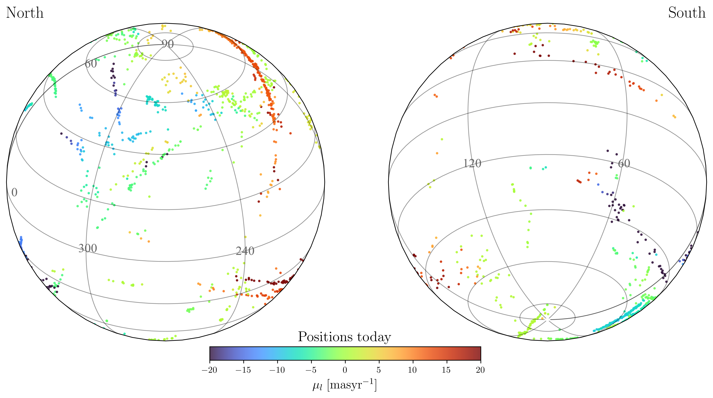
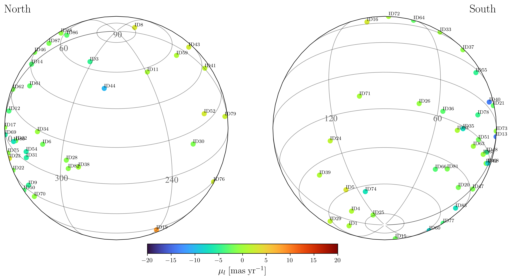
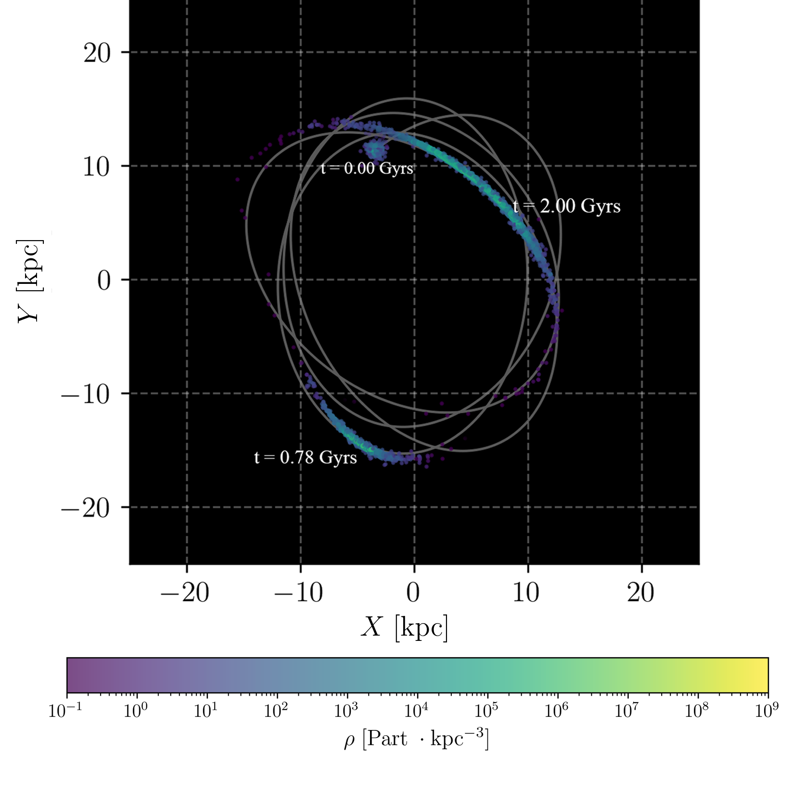
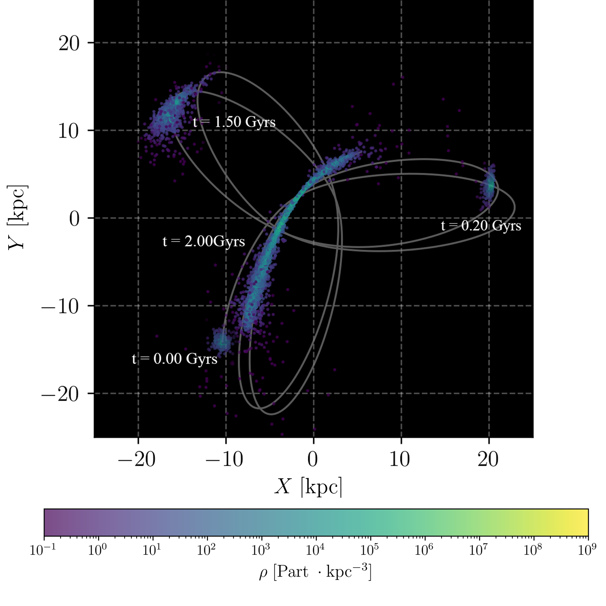
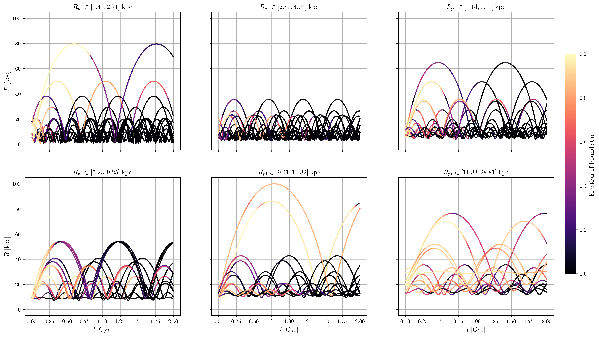
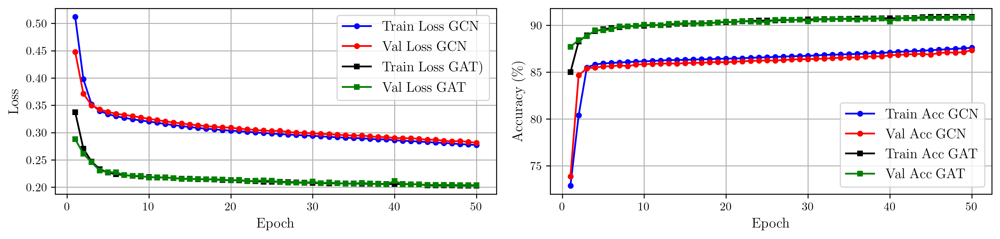
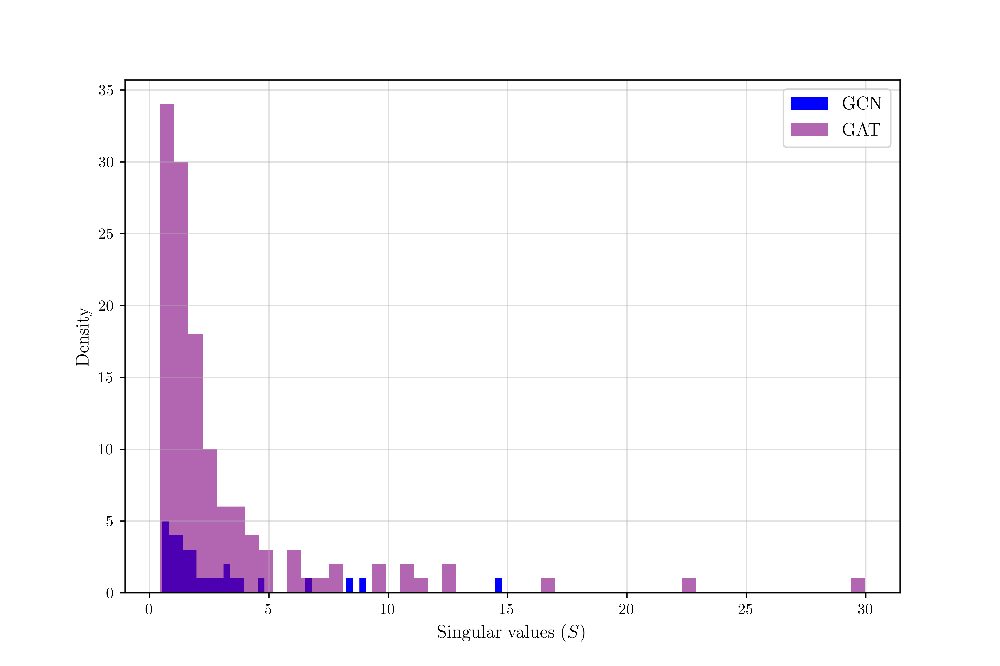
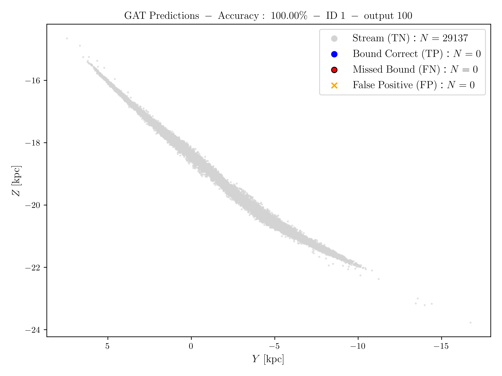
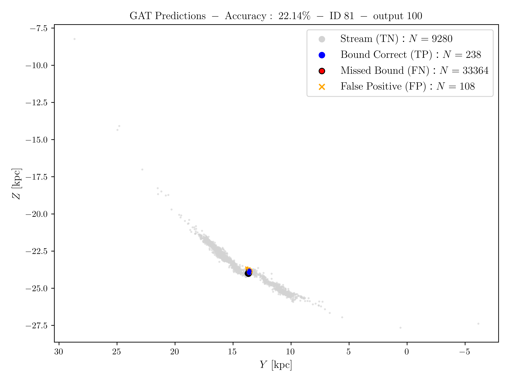
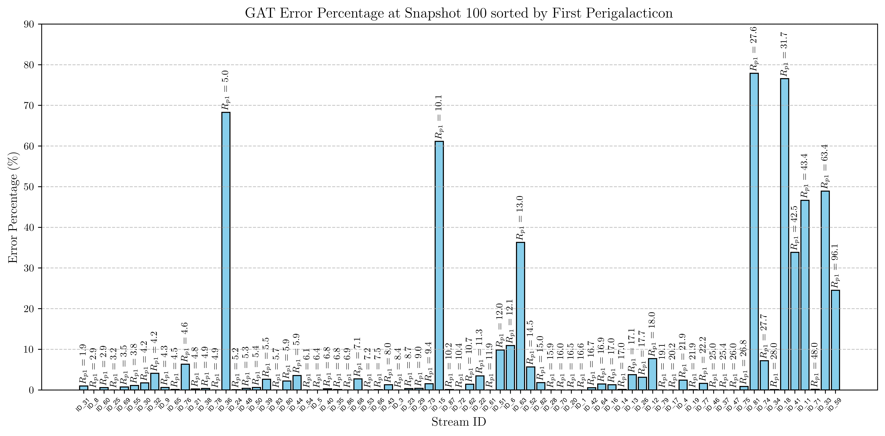

# Identifying Potential Escapers with Graph Neural Networks: Recovering Cluster Dynamics from Partial Kinematics

**Author:** Adrian Cozma ([@adricozma](https://github.com/adricozma))  
**Affiliation:** Laboratory of Astrophysics (LASTRO), École Polytechnique Fédérale de Lausanne (EPFL)  
**Supervisors:** Prof. Yves Revaz, Dr. Srikanth Nagesh  

---

## Overview

As globular clusters orbit the Milky Way, gravitational tidal forces strip stars from their outer envelopes, forming elongated **stellar streams**. Determining whether an observed star remains gravitationally bound to the progenitor core, is a **potential escaper** trapped inside the Jacobi surface with excess energy, or has already escaped into the unbound tidal tails formally requires full 6D phase-space coordinates $(x, y, z, v_x, v_y, v_z)$ and explicit knowledge of the host galactic potential.

In observational surveys such as *Gaia*, however, radial velocities $(v_{\mathrm{los}})$ are missing for the vast majority of faint stars $(G \gt 16)$, leaving only 5D astrometric measurements: sky positions $(\alpha, \delta)$, parallax $(\varpi)$, and proper motions $(\mu_{\alpha^*}, \mu_\delta)$.

This repository provides a complete numerical and deep-learning pipeline that:
1. Reconstructs realistic progenitor initial conditions via backward orbit integration of observed Milky Way stellar streams from the *Gaia* DR3 atlas (Ibata et al. 2024) inside a realistic three-component Milky Way potential (`MWPotential2014`, Bovy 2015).
2. Evolves 81 self-consistent *N*-body Plummer globular clusters forward in time for $2.0\text{ Gyr}$ using the cosmological/astrophysical code `SWIFT` (Schaller et al. 2024) on the EPFL HPC cluster **Jed** (and 75 clusters in Study 1).
3. Computes exact physical boundness and potential escaper labels from 3D Jacobi energies and tidal radii following Küpper et al. (2010a,b), using a 3D *k*-nearest-neighbor local density estimator (Casertano & Hut 1985) and iterative shrinking spheres to track the surviving core accurately even in heavily stripped streams.
4. Projects the simulations into synthetic 5D *Gaia*-like astrometric observables with data augmentation over random observer orientations and physical-scale standardization.
5. Trains **Residual Graph Convolutional Networks (GCN)** and **Multi-Head Residual Graph Attention Networks (GAT)** with local phase-space relational encoding (`3d + 3` invariants) on *k*-NN graphs $(k = 20)$, using **Two-Stage Curriculum Learning** (noiseless pre-training $\to$ *Gaia* DR3 magnitude-dependent noisy fine-tuning), **subspace-aligned $5\mathrm{D} \to 4\mathrm{D}$ weight transfer** for systematic observable ablations, and multi-node distributed training with micro-batch gradient accumulation and automatic disk activation offloading.

> **Live Training Progress & Master Interactive HTML Dashboard:**  
> - **Master Interactive HTML Index (All Trainings & Plotly Views in One Page):** [**`index.html`**](index.html) (also mirrored at [**`GNN-jed/trained_models/study2/index.html`**](GNN-jed/trained_models/study2/index.html))  
> - **Real-Time Telemetry & RMT Candle Spectra Markdown:** [**`LIVE_STATUS.md`**](LIVE_STATUS.md)  
> - **Model Checkpoints Registry (`.pth`):** [**`GNN-jed/trained_models/study2/weights/MODEL_WEIGHTS_REGISTRY.md`**](GNN-jed/trained_models/study2/weights/MODEL_WEIGHTS_REGISTRY.md)

---

## Repository Structure

The repository is organized to separate core physical/feature-engineering modules (`src/`), executable production pipelines (`scripts/`), SLURM cluster templates (`slurm/`), initial condition generation (`make_ICs/`), visualization utilities (`visualization/`), and interactive analysis notebooks (`notebooks/`):

```text
.
├── assets/
│   └── figures/                         # Figures from simulations, orbital dynamics, and GNN evaluation
├── configs/
│   ├── params.yml                       # SWIFT runtime configuration (MilkyWayPotential2014, leapfrog/gravity)
│   └── dependency_graph_0.csv           # SWIFT task-level dependency graph
├── make_ICs/
│   ├── Ibata_catalog.txt                # Gaia DR3 stellar stream catalog (Ibata et al. 2024)
│   ├── stars_6D_ibata2024.csv           # Filtered 6D stream stars used to define progenitor orbits
│   ├── select_unbiased_orbits.py        # Unbiased progenitor orbit selector (R_p >= 0.0 kpc, 81 streams)
│   ├── generate_unbiased_ics.py         # Batch virialized Plummer sphere HDF5 generator for SWIFT
│   ├── IC_plummer_swift.py              # Isotropic/anisotropic Plummer sphere HDF5 generator
│   ├── OrbitIntegration_Ibata.ipynb     # Backward orbit integration (-2 Gyr) in galpy MWPotential2014
│   ├── WorkflowIbata.ipynb              # Catalog processing and progenitor seed extraction workflow
│   ├── SWIFT_seeds.npy                  # Study 1 6D phase-space seeds at t = -2 Gyr (75 streams)
│   ├── SWIFT_seeds_unbiased.npy         # Study 2 unbiased 6D phase-space seeds at t = -2 Gyr (81 streams)
│   ├── unbiased_orbits_summary.csv      # Orbital parameters (R_p, R_a, eccentricity) across streams
│   ├── orbits/                          # Integrated 2 Gyr orbital trajectories (Study 1)
│   └── orbits_unbiased/                 # Integrated 2 Gyr unbiased orbital trajectories (Study 2)
├── src/
│   ├── bound_labels.py                  # 3D k-NN density + shrinking-sphere centering & exact Jacobi/Roche solver
│   ├── observables_matrix.py            # Haar-uniform SO(3) rotations, ICRS projection, Gaia DR3 noise & scaling (V1)
│   ├── gaia_v2.py                       # Study 2 V2: Kroupa IMF + RGB/MSTO (G<=20.7), linear parallax, MW field stars
│   ├── gnn_models.py                    # V1 Local phase-space relational encoder, Residual GCN & Multi-Head GAT
│   ├── gnn_models_v2.py                 # V2 Uncertainty-aware GAT_V2 (edge_dim=3) & GCN_V2 with N-invariant density
│   ├── oom_Pin_and_offload.py           # Distributed DDP initializer & cgroup-aware disk activation offloader
│   └── Stellar_objects/                 # Utilities for King/Plummer cluster profiles and LOS dispersion
├── scripts/
│   ├── extract_observables.py           # Parallel extraction of bound labels + Clean & Gaia DR3 Noisy observables
│   ├── build_graph_dataset.py           # Parallel cKDTree k-NN graph builder (5D full & 4D ablation subsets)
│   ├── distributed_trainer.py           # Unified DDP, RAM graph cache, micro-batch grad accumulation & checkpoint engine
│   ├── train_gcn.py                     # 3-layer Residual GCN classifier training CLI (clean_5obs baseline)
│   ├── train_gat.py                     # 3-layer Multi-Head Residual GAT training & curriculum fine-tuning CLI
│   ├── v2_extract_observables.py        # Study 2 V2: Parallel extraction with IMF, G<=20.7, and MW field stars
│   ├── v2_build_graph_dataset.py        # Study 2 V2: Pure 2D on-sky (RA*, Dec) k=32 k-NN graph builder
│   ├── v2_train_gat.py                  # Study 2 V2: Unified 3-class DDP trainer for GAT_V2 and GCN_V2 (--arch gat|gcn)
│   ├── v2_select_best_4d.py             # Study 2 V2: Automated selector for the winning V1 4D noisy subset
│   ├── v2_infer_gaia_dr3.py             # Study 2 V2: Calibrated inference on real Gaia DR3 and Ibata (2024) catalogs
│   ├── generate_study2_figures.py       # Automated evaluation & publication figure generator (.png & .html)
│   ├── live_plot_utils.py               # Real-time learning curve plotter from training logs
│   └── live_monitor.py                  # Automated telemetry, LIVE_STATUS.md, ntfy, and GitHub status updater
├── slurm/
│   ├── step1_orbits_and_ics.sh          # Step 1: Orbit integration & Plummer HDF5 initial conditions
│   ├── step2_run_swift_array.sh         # Step 2: SWIFT N-body simulation job array
│   ├── step3_extract_observables.sh     # Step 3: Bound label & Clean/Noisy observable extraction
│   ├── step4_build_graphs.sh            # Step 4: 5D cKDTree k-NN PyTorch Geometric graph construction
│   ├── step5_train_curriculum_and_plot.sh # Step 5: 5-Observable Clean -> Gaia DR3 Noisy curriculum training
│   ├── step6_ablation_4obs.sh           # Step 6: 4-Observable ablation study (5D -> 4D weight transfer)
│   ├── step7_retrain_gcn_stochastic.sh  # Step 7: Stochastic SO(3) GCN Clean baseline retraining
│   ├── launch_full_study2_pipeline.sh   # Master SLURM pipeline launcher chaining Steps 5, 6, and 7
│   ├── v2_step3_extract_obs.sh          # V2 Step 3: Extract IMF + G<=20.7 + MW field contaminants (array 0-80%8)
│   ├── v2_step4_build_graphs.sh         # V2 Step 4: Best-4D selection & 2D-sky k=32 k-NN graphs
│   ├── v2_step5_train_5d.sh             # V2 Step 5: Train V2 5D Clean -> Noisy Curriculum GAT_V2
│   ├── v2_step6_train_best4d.sh         # V2 Step 6: Train V2 Best-4D GAT_V2 + Gaia DR3 inference (GAT 5D & 4D)
│   ├── v2_step7_train_gcn.sh            # V2 Step 7: Train V2 5D & Best-4D GCN_V2 + Gaia DR3 inference (GCN 5D & 4D)
│   └── launch_study2_v2.sh              # Master SLURM launcher chaining V2 Steps 3 -> 4 -> 5 -> 6 -> 7
├── tests/
│   └── test_v2_pipeline.py              # Unit and end-to-end smoke tests for Study 2 V2
├── visualization/
│   ├── plot_swift_output.py             # HDF5 snapshot loader (DMParticles coordinates, velocities, masses, time)
│   ├── visu_stream_outputs.py           # 3D Galactocentric stream rendering and projection animations
│   ├── plot_metric_live.py              # Training vs. validation loss curve plotter from training logs
│   ├── final_sims_vizu.ipynb            # All-sky orthographic (Cartopy) and depth-sorted Galactocentric plots
│   └── fraction_bound_stars.ipynb       # Bound fraction evolution vs. orbital eccentricity and perigalacticon
├── notebooks/
│   ├── labels_data_matrices.ipynb       # Interactive generation and verification of labels and observable matrices
│   ├── graph_data.ipynb                 # PyTorch Geometric k-NN graph construction from 5D observables
│   └── test-model-GCN.ipynb             # Model inference, perigalacticon error analysis, and RMT SVD diagnostics
└── GNN-jed/
    └── trained_models/
        ├── GCN-01/                      # Study 1 baseline GCN weights (best_gnn_model_01.pth) & logs
        ├── GCN-02/                      # Study 1 multi-head GAT weights (best_gnn_model_02.pth) & logs
        ├── study2/                      # Study 2 V1 curriculum & ablation logs, figures, and checkpoints
        │   └── weights/                 # Central archive of best_*.pth checkpoints & MODEL_WEIGHTS_REGISTRY.md
        └── study2_v2/                   # Study 2 V2 logs, checkpoints, best_4d_config.*, and Gaia DR3 inference CSVs
```

*Note:* Bulk `SWIFT` simulation snapshots, intermediate `.npy` observable/label arrays, and serialized `.pt` graph datasets are excluded from version control via `.gitignore` and can be generated in any user-specified local or scratch directory (`$DATA_DIR`).

---

## Physical & Methodological Pipeline

### 1. Progenitor Orbit Reconstruction & *N*-Body Simulations (`make_ICs/`, `configs/`)

Starting from the *Gaia* DR3 stellar stream catalog of Ibata et al. (2024), stars with complete 6D phase-space measurements are grouped by stream identifier (`Track`). Representative present-day stream anchors are integrated backward in time for $\Delta t = -2.0\text{ Gyr}$ using `galpy` (Bovy 2015) inside `MWPotential2014` — a three-component potential comprising a Miyamoto-Nagai disk, a power-law bulge with exponential cut-off, and an NFW dark matter halo, calibrated to $R_0 = 8.0\text{ kpc}$ and $V_c = 220\text{ km s}^{-1}$.

| Present-Day Stream Anchors $(t = 0\text{ Gyr})$ | Backward-Integrated Progenitor Seeds $(t = -2.0\text{ Gyr})$ |
| :---: | :---: |
|  |  |

At each $t = -2.0\text{ Gyr}$ seed position, an isotropic $(q = 0)$ Plummer sphere (Plummer 1911) is initialized via `make_ICs/IC_plummer_swift.py` (Study 1 baseline: $M = 10^4\,M_\odot$, $a = 4\text{ pc}$, $N \in [2500, 3500]$; Study 2 unbiased benchmark via `make_ICs/generate_unbiased_ics.py`: 75 symlinked Study 1 streams plus 6 massive outer-halo progenitors spanning $N \in [20\,000, 50\,000]$ and $a \in [1, 50]\text{ pc}$):

$$
\rho(r) = \frac{3M}{4\pi a^3}\left(1 + \frac{r^2}{a^2}\right)^{-5/2}, \qquad \Phi(r) = -\frac{GM}{\sqrt{r^2 + a^2}}.
$$

Each cluster is evolved forward for $2.0\text{ Gyr}$ in `SWIFT` (Schaller et al. 2024) using `configs/params.yml` with 101 HDF5 snapshots per simulation $(\Delta t_{\mathrm{snap}} = 20\text{ Myr})$ and a comoving Plummer-equivalent softening length $\epsilon = 1\text{ pc}$ (Study 1) or $\epsilon = 5\text{ pc}$ (Study 2 `configs/params.yml`).

| Tidal Disruption Sequence (`IC_53`, Low Perigalacticon) | Multi-Epoch Stream Formation (`IC_70`) |
| :---: | :---: |
|  |  |

---

### 2. Dynamical Boundness, Potential Escapers & Orbital Evolution (`src/bound_labels.py`)

Following Binney & Tremaine (2008) and Küpper et al. (2010a,b), a star in a cluster orbiting at galactocentric distance $R_{\mathrm{gal}}$ with instantaneous angular velocity $\mathbf{\Omega} = (\mathbf{R}_{\mathrm{gal}} \times \mathbf{V}_{\mathrm{gal}}) / R_{\mathrm{gal}}^2$ experiences an effective tidal boundary given by the King (1962) / Jacobi radius:

$$
R_J = \left(\frac{G M(\lt R_J)}{\Omega^2 - \frac{\partial^2 \Phi_{\mathrm{gal}}}{\partial R_{\mathrm{gal}}^2}}\right)^{1/3}, \qquad E_{\mathrm{crit}} = -\frac{3}{2}\frac{G M(\lt R_J)}{R_J}.
$$

Each star's specific Jacobi energy in the co-rotating frame relative to the surviving cluster core is:

$$
E_J = \frac{1}{2}\lVert\mathbf{v}_{\mathrm{rel}}\rVert^2 + \Phi_{\mathrm{cluster}}(r_{3D}) - \frac{1}{2}\left[\Omega^2 r_{3D}^2 - (\mathbf{\Omega}\cdot\mathbf{r}_{\mathrm{rel}})^2\right].
$$

To prevent extended, asymmetric tidal tails from biasing the cluster center-of-mass toward empty space between the tails, `src/bound_labels.py` locates the surviving core via a 3D *k*-nearest-neighbor local density estimator $\rho_i \propto d_{k,i}^{-3}$ (Casertano & Hut 1985) followed by an iterative shrinking-sphere refinement from $0.5\text{ kpc}$ down to $0.05\text{ kpc}$. Stars are classified into:
- **Bound Core Stars (`label = 1`):** $E_J \lt E_{\mathrm{crit}}$ and $r_{3D} \lt R_J$ (solved iteratively to convergence).
- **Potential Escapers:** $E_J \ge E_{\mathrm{crit}}$ and $r_{3D} \lt R_J$ (stars energetically unbound that remain spatially trapped inside the Jacobi surface near the $L_1 / L_2$ Lagrange points).
- **Unbound Stream Stars (`label = 0`):** Stars outside the Jacobi radius or exceeding the critical Jacobi energy.


*Evolution of the Galactocentric radius $R(t)$ over $2.0\text{ Gyr}$ across simulated clusters (75 in Study 1, expanded to 81 unbiased streams in Study 2), grouped into six panels by their first perigalacticon distance $R_{p1}$ and color-coded by the instantaneous fraction of bound stars.*

---

### 3. Synthetic 5D *Gaia* Observables & *k*-NN Graph Construction (`src/observables_matrix.py`)

For each snapshot, the 3D Galactocentric particle coordinates are rotated by $n_{\mathrm{rot}} = 5$ Haar-uniform 3D Euler matrices $\mathbf{R} \in \mathrm{SO}(3)$ to augment viewing angles, transformed into the heliocentric International Celestial Reference System (ICRS) via `astropy.coordinates.SkyCoord`, optionally perturbed with Lindegren et al. (2021) *Gaia* DR3 astrometric uncertainties at reference absolute magnitude $M_G = 4.5$ (`inject_gaia_dr3_noise`), and restricted to the 5D observable vector:

$$
\mathbf{x}_i = \left(\Delta\alpha_i\cos\delta_c,\; \Delta\delta_i,\; D_i,\; \mu_{\alpha^*,i},\; \mu_{\delta,i}\right) \in \mathbb{R}^5, \qquad D_i = \frac{1}{\mathrm{clip}(\varpi_{\mathrm{obs},i},\, 0.005,\, 10.0)}\text{ kpc}.
$$

In `src/observables_matrix.py`, Right Ascension is centered via the circular median on $\mathbb{S}^1$ and projected onto the local tangent plane. `standardise_matrix` supports both `mode="physical"` (fixed galactic scale factors) and `mode="zscore"` ($6\sigma_{\mathrm{MAD}}$ winsorization followed by per-snapshot Z-score standardization); the live Study 2 benchmark extraction (`slurm/step3_extract_observables.sh`) ran with `--norm_mode zscore --n_rotations 5 --abs_mag_g 4.5`. Directed *k*-nearest-neighbor graphs $(k = 20)$ are built in standardized 5D (or 4D ablation) feature space using `scipy.spatial.cKDTree` (`scripts/build_graph_dataset.py`).

---

### 4. Graph Neural Network Architectures, Mathematical Know-How, Curriculum Learning & 5D $\to$ 4D Ablation Transfer (`src/`, `scripts/`, `slurm/`)

#### A. Breaking Constant-Degree $k$-NN Scale Blindness (`compute_node_relational_features`)
In a constant-degree $k$-NN graph ($k = 20$), every star has the exact same topological degree $\deg(i) = 20$, regardless of whether those 20 neighbors lie within $0.5\text{ pc}$ inside a dense bound core ($r_i < R_J$) or span $5\text{ kpc}$ along a diffuse tidal tail ($r_i \gg R_J$). To break this topological scale blindness, [`src/gnn_models.py`](src/gnn_models.py) augments each star's standardized astrometric vector $\mathbf{x}_i \in \mathbb{R}^d$ ($d \in \{4, 5\}$) with its local $k$-NN phase-space relational invariants:

$$
\mathbf{h}_i^{(0)} = \left[\underbrace{\mathbf{x}_i}_{d},\; \underbrace{\mathbf{x}_i - \langle\mathbf{x}\rangle_{\mathcal{N}(i)}}_{d},\; \underbrace{\boldsymbol{\sigma}_{\mathcal{N}(i)}}_{d},\; \underbrace{\bar{d}_i,\; \ln\hat{\rho}_{\mathrm{phase},i},\; \lVert\mathbf{x}_i\rVert_2}_{3}\right] \in \mathbb{R}^{3d + 3}.
$$

#### B. Why Anisotropic Multi-Head GAT Outperforms Isotropic GCN Across the Jacobi Boundary ($r \approx R_J$)
We compare two 3-layer residual architectures across **81 unbiased *Gaia* DR3 progenitor streams** (partitioned deterministically at the simulation level with `seed=42` into **65 Train / 8 Validation / 8 Test** simulations — zero data leakage across snapshots or rotations):

1. **Isotropic 3-Layer Residual GCN (`scripts/train_gcn.py`):** `(3d+3) -> 64 -> 128 -> 1` with `GCNConv(h, E)`, linear residual skip projections (`skip1`, `skip2`), `LayerNorm`, `GELU` activations, and an ego-relational readout head `MLP([h2, h0])`. Because `GCNConv` averages all neighbors $j \in \mathcal{N}(i)$ with fixed degree weights $1/\sqrt{\tilde{d}_i\tilde{d}_j} \approx 1/21$, stars located near the Jacobi boundary ($r_i \approx R_J$, near the $L_1/L_2$ Lagrange points) have their features smoothed isotropically across both bound core neighbors and unbound escaping neighbors.
2. **Anisotropic 3-Layer Multi-Head Residual GAT (`scripts/train_gat.py`):** `GATConv(3d+3, 32, heads=4)` $\to$ `GATConv(128, 64, heads=4)` $\to$ `GATConv(256, 1, heads=1)` with `LayerNorm`, `ELU` activations, linear residual skip connections (`skip1`, `skip2`), and dual ego-relational readout:

$$
e_{ij}^{(m)} = \mathrm{LeakyReLU}_{0.2}\!\left(\mathbf{a}_{\mathrm{src}}^{(m)\top}\mathbf{W}^{(m)}\mathbf{h}_i^{(l-1)} + \mathbf{a}_{\mathrm{dst}}^{(m)\top}\mathbf{W}^{(m)}\mathbf{h}_j^{(l-1)}\right), \qquad \alpha_{ij}^{(m)} = \frac{\exp(e_{ij}^{(m)})}{\sum_{u \in \mathcal{N}(i) \cup \{i\}} \exp(e_{iu}^{(m)})},
$$

$$
\mathbf{h}_i^{(l)} = \mathrm{ELU}\!\left(\mathrm{LayerNorm}\!\left(\mathrm{Concat}_{m=1}^{4}\!\left[\sum_{j \in \mathcal{N}(i) \cup \{i\}} \alpha_{ij}^{(m)}\mathbf{W}^{(m)}\mathbf{h}_j^{(l-1)}\right] + \mathbf{W}_{\mathrm{skip},l}\,\mathbf{h}_i^{(l-1)}\right)\right), \qquad \hat{y}_i = \mathrm{conv3}(\mathbf{h}_i^{(2)}, \mathcal{E}) + \mathrm{MLP}_{\mathrm{ego}}\!\left([\mathbf{h}_i^{(2)} \;\Vert\; \mathbf{h}_i^{(0)}]\right).
$$

   - **Physical Role of Multi-Head Attention:** Unlike GCN, the $M=4$ attention heads learn **anisotropic weights** $\alpha_{ij}^{(m)}$ that suppress high-velocity escapers or phase-space outliers ($\alpha_{ij} \to 0$) while concentrating message passing onto kinematically coherent core members ($\|\boldsymbol{\mu}_j - \boldsymbol{\mu}_i\| \to 0$), preserving a sharp decision boundary right at $R_J$.
   - **Decoupled Feature vs. Attention-Edge Dropout (`src/gnn_models.py`):** Hidden feature dropout is set to $p_{\mathrm{node}} \in [0.20, 0.25]$, while `GATConv` attention-edge dropout is capped at $p_{\mathrm{edge}} = \min(p_{\mathrm{node}}, 0.15)$ on `conv1`/`conv2` and explicitly set to $p_{\mathrm{edge}} = 0.0$ on the final 1-head scalar logit layer `conv3`. (Applying $p=0.4$ edge dropout on `conv3` randomly zeroes $40\%$ of output logit contributions and causes capacity throttling / underfitting, reducing 5D Clean Test Accuracy from **93.04%** to **91.43%**.)

#### C. Quantitative Benchmark Summary on the 81-Stream Study 2 V1 Test Set (4,040 Test Graphs)

| Model Checkpoint | Regime | Best Epoch | Val Loss / Acc | **Test Loss** | **Test Acc** | **Test BalAcc** | **Test F1** | **Surviving-Core Error (`CoreFNR`)** |
| :--- | :---: | :---: | :---: | :---: | :---: | :---: | :---: | :---: |
| **`best_gat_clean.pth`** *(Canonical Ep 18)* | 5D Clean | 18 | `0.1470` / **94.20%** | **0.1641** | **93.04%** | **93.15%** | **0.9035** | **6.49%** (`CoreRec: 93.51%`) |
| **`best_gcn_clean.pth`** *(Baseline GCN)* | 5D Clean | 24 | `0.1817` / 92.32% | 0.1841 | 92.17% | 91.59% | 0.8886 | 10.32% (`CoreRec: 89.68%`) |
| `best_gat_clean_dropout04_ep35.pth` *(Archived)* | 5D Clean (`0.40` drop) | 35 | `0.2071` / 91.89% | 0.2016 | 91.43% | 91.28% | 0.8807 | 9.22% (`CoreRec: 90.78%`) |
| **`best_gat_noisy.pth`** *(V1 5D Noisy)* | 5D *Gaia* DR3 Noisy | 12 | `0.4014` / 81.76% | 0.3181 | **84.91%** | **83.88%** | **0.7879** | 19.52% (`CoreRec: 80.48%`) |
| `best_gat_4obs_no_pmRA_clean.pth` | 4D Clean (no $\mu_{\alpha^*}$) | 15 | `0.1810` / 92.76% | 0.1848 | 92.25% | 92.37% | 0.8929 | 7.20% (`CoreRec: 92.80%`) |
| `best_gat_4obs_no_pmDec_clean.pth` | 4D Clean (no $\mu_\delta$) | 16 | `0.1931` / 91.92% | 0.1883 | 92.02% | 92.32% | 0.8907 | 6.67% (`CoreRec: 93.33%`) |
| `best_gat_4obs_no_Dec_clean.pth` | 4D Clean (no $\delta$) | 13 | `0.1803` / 92.78% | 0.2060 | 91.48% | 91.62% | 0.8828 | 7.90% (`CoreRec: 92.10%`) |
| `best_gat_4obs_no_Parallax_clean.pth` | 4D Clean (no $D(\varpi)$) | 13 | `0.2208` / 90.96% | 0.2289 | 90.25% | 90.83% | 0.8689 | 7.27% (`CoreRec: 92.73%`) |
| `best_gat_4obs_no_RA_clean.pth` | 4D Clean (no $\alpha^*$) | 16 | `0.2292` / 90.59% | 0.2420 | 89.54% | 89.18% | 0.8543 | 12.00% (`CoreRec: 88.00%`) |
| **`best_gat_4obs_no_Parallax_noisy.pth`** *(Winning 4D Noisy)* | 4D *Gaia* DR3 Noisy | 13 | `0.3839` / 82.88% | **0.2934** | **86.72%** | **87.91%** | **0.8281** | **8.14%** (`CoreRec: 91.86%`) |
| `best_gat_4obs_no_pmDec_noisy.pth` | 4D Noisy (no $\mu_\delta$) | 11 | `0.3809` / 81.45% | 0.3308 | 84.15% | 82.43% | 0.7714 | 23.23% (`CoreRec: 76.77%`) |
| `best_gat_4obs_no_pmRA_noisy.pth` | 4D Noisy (no $\mu_{\alpha^*}$) | 11 | `0.3839` / 81.32% | 0.3320 | 84.06% | 82.37% | 0.7705 | 23.21% (`CoreRec: 76.79%`) |
| `best_gat_4obs_no_RA_noisy.pth` | 4D Noisy (no $\alpha^*$) | 3 | `0.4650` / 77.82% | 0.4781 | 76.62% | 71.74% | 0.6238 | 44.35% (`CoreRec: 55.65%`) |

*(Note: `4obs_no_Dec_noisy` was intentionally omitted after `4obs_no_Dec_clean` closely tracked `4obs_no_RA_clean` at 91.48% / 0.8828 F1 and `4obs_no_Parallax_noisy` already established the 4D noisy winner by removing V1's singular $1/\varpi_{\mathrm{obs}}$ distance channel, freeing compute for the Study 2 V2 pipeline where both $(\alpha^*, \delta)$ are required for 2D sky topology.)*

> **Why V1 5D Noisy Drops to 84.91% (and Why `4obs_no_Parallax_noisy` Reaches 86.72%):**  
> In V1 `noisy_5obs`, column 2 is the inverted distance $D_i = 1/\mathrm{clip}(\varpi_{\mathrm{obs},i}, 0.005, 10)\text{ kpc}$. At halo distances ($10\text{--}40\text{ kpc}$, where $\sigma_\varpi > \varpi_{\mathrm{true}}$ at $M_G=4.5$), $\sim 40\%$ of noisy parallax draws fall below $0.005\text{ mas}$ and pile up at $D_i = 200\text{ kpc}$, distorting the 5D $k$-NN graph topology before message passing begins. Dropping parallax in **`4obs_no_Parallax_noisy`** eliminates this boundary pile-up and improves noisy Test Accuracy from **84.91%** to **86.72%** (`F1 = 0.8281`, cutting `CoreFNR` from **19.52%** to **8.14%**). **Study 2 V2** eliminates the root cause in 5D by constructing edges strictly in 2D sky coordinates $(\Delta\alpha^*, \Delta\delta)$ and replacing $1/\varpi_{\mathrm{obs}}$ with linear signed $\varpi_{\mathrm{obs}}$.

#### Two-Stage Curriculum, Stochastic $\mathrm{SO}(3)$ Training & $5\mathrm{D} \to 4\mathrm{D}$ Subspace Weight Transfer
- **Step 5 — 5-Observable Curriculum (`slurm/step5_train_curriculum_and_plot.sh`):** Both GCN (25 epochs, architectural baseline) and GAT (50 epochs, `--stochastic_rotation` sampling 1 random rotation per snapshot per epoch across $6\,565$ training graphs/epoch) are trained on noiseless 5D astrometric graphs (`clean_5obs`, $\mathrm{lr} = 10^{-3}$). The converged 5D Clean GAT checkpoint (`best_gat_clean.pth`) is then fine-tuned for up to 30 epochs (`patience = 8`) on *Gaia* DR3 noisy graphs (`noisy_5obs`, $\mathrm{lr} = 5\times 10^{-4}$, Lindegren et al. 2021).
- **Step 6 — 4-Observable Ablation Study (`slurm/step6_ablation_4obs.sh`):** To isolate the physical contribution of each astrometric coordinate (`no_RA`, `no_Dec`, `no_Parallax`, `no_pmRA`, `no_pmDec`), each 4D GAT model ($3d+3 = 15$ input channels) is initialized directly from the converged 5D Clean GAT weights ($18$ input channels) via `load_pretrained_with_channel_adaptation` (`src/gnn_models.py`). All internal message-passing and attention layers are copied identically ($100\%$ preservation), while first-layer projections (`conv1.lin.weight`, `skip1.weight`, and the `h0` slice of `ego_head.0.weight`) are sliced along the retained coordinate indices $\pi(\mathcal{I}) = \mathcal{I} \cup (5+\mathcal{I}) \cup (10+\mathcal{I}) \cup \{15,16,17\}$ and scaled by $\sqrt{18/15}$ prior to 4D Clean pre-training (up to 20 epochs, `patience = 8`) and 4D *Gaia* DR3 noisy fine-tuning (up to 20 epochs, `patience = 8`).
- **Step 7 — Stochastic GCN Retraining (`slurm/step7_retrain_gcn_stochastic.sh`):** Archives the completed static-5-rotation Clean GCN baseline (`Test Acc = 92.17%`, `BalAcc = 91.59%`, `F1 = 0.8886`) into `GNN-jed/trained_models/study2/legacy/clean_5obs_static_5rot/` and retrains Clean GCN for 25 epochs using `--stochastic_rotation --bf16 --bs 256` for direct regime parity with Stochastic GAT (noting that `--bs 256` performs $\sim 650$ optimizer updates over 25 epochs vs. GAT's $\sim 5\,150$ updates over 50 epochs at `--bs 64`).

#### Multi-Node Distributed Execution & Memory Optimization (`scripts/distributed_trainer.py`, `src/oom_Pin_and_offload.py`)
- **Multi-Node DDP & Micro-Batch Gradient Accumulation:** Supports single-machine execution (CPU or GPU) as well as multi-node SLURM `DistributedDataParallel` (`srun` / `torchrun`). Exact node-weighted gradient accumulation over micro-batches (`--micro_bs`) preserves the global effective batch size (`256` for GCN, `64` for GAT) while allowing SLURM wrappers (`run_ddp_with_oom_fallback`) to halve `--micro_bs` automatically and resume from the latest epoch checkpoint if memory limits are approached.
- **Disk Activation Offloading (`DiskActivationOffloader`):** Cgroup-aware saved-tensor hooks (`torch.autograd.graph.saved_tensors_hooks`) monitor node memory against `/sys/fs/cgroup/memory.current` vs. `memory.max` and stream large ($> 8\text{ MB}$) activation tensors to `/scratch` when utilization exceeds $70\%$ (triggered dynamically by node memory pressure; `force_enable` is currently `False` in `distributed_trainer.py`).

| Training & Validation Loss Convergence (GCN vs. GAT) | Weight Matrix Singular Value Spectrum (RMT) |
| :---: | :---: |
|  |  |

In Study 1 ($75$ clusters, $t = 2.0\text{ Gyr}$, snapshot 100), the multi-head GAT achieved **96.26% mean node accuracy**, separating surviving bound cores from stripped tidal tails while concentrating remaining errors on marginal systems near $R_{p1} \in [8, 18]\text{ kpc}$. In the expanded 81-stream Study 2 V1 benchmark, the 5D Clean GAT achieved **93.04% Test Accuracy** (`F1 = 0.9035`, `CoreFNR = 6.49%`), outperforming the 5D Clean GCN (**92.17%**, `F1 = 0.8886`, `CoreFNR = 10.32%`), while the Step 6 4D Leave-One-Observable-Out ablations identified `4obs_no_Parallax_noisy` (**86.72%**, `F1 = 0.8281`, `CoreFNR = 8.14%`) as the top noisy 4D configuration (see [**`LIVE_STATUS.md`**](LIVE_STATUS.md) and [`GNN-jed/trained_models/study2/weights/MODEL_WEIGHTS_REGISTRY.md`](GNN-jed/trained_models/study2/weights/MODEL_WEIGHTS_REGISTRY.md)).

| Dissolved Stream (`IC_1`, $R_{p1} = 1.9\text{ kpc}$, 100% Accuracy) | Surviving Bound Core (`IC_81`, $R_{p1} = 16.5\text{ kpc}$, 98.11% Accuracy) |
| :---: | :---: |
|  |  |


*Classification error percentage at $t = 2.0\text{ Gyr}$ (snapshot 100) across simulated streams ordered by first perigalacticon distance $R_{p1}$. Streams with small $R_{p1}$ are completely disrupted early on, whereas clusters with intermediate $R_{p1}$ retain marginally bound cores rich in potential escapers.*

---

## Installation & Reproducibility Guide

Follow the steps below to reproduce the entire pipeline — from progenitor orbit integration and *N*-body simulations to graph construction, curriculum training, 4-observable ablations, and figure generation.

### 1. Environment Setup

Clone the repository and create a Python 3.10+ virtual environment with the required astrophysics and PyTorch Geometric packages:

```bash
git clone https://github.com/adricozma/GnnClusterClassifier.git
cd GnnClusterClassifier

python3 -m venv env_astro
source env_astro/bin/activate

pip install --upgrade pip
pip install numpy scipy pandas matplotlib h5py astropy galpy swiftsimio unyt cartopy plotly
pip install torch torch_geometric torch_cluster
```

Define a working directory `DATA_DIR` with sufficient storage for simulation snapshots, extracted observables, and graph datasets:

```bash
export DATA_DIR="./data_study2"
mkdir -p "$DATA_DIR"
```

---

### 2. Step-by-Step Data Generation (Steps 1–4)

#### Step 1: Progenitor Orbits & Virialized Plummer Initial Conditions
Select the 81 unbiased Milky Way stream progenitors ($R_p \ge 0.0\text{ kpc}$ in `MWPotential2014`, retaining both close-pericenter dissolving systems and outer-halo clusters inside $\max(|x|,|y|,|z|) \le 480\text{ kpc}$) and generate virialized Plummer `.hdf5` initial conditions at $t = -2.0\text{ Gyr}$:

```bash
python3 make_ICs/select_unbiased_orbits.py
python3 make_ICs/generate_unbiased_ics.py
```

#### Step 2: *N*-Body Evolution in `SWIFT`
Evolve each initial condition `make_ICs/initial_conditions_unbiased/IC_<ID>.hdf5` forward for $2.0\text{ Gyr}$ (101 snapshots, $\Delta t = 20\text{ Myr}$) using `SWIFT` compiled with `--with-ext-potential=MWPotential2014` and `configs/params.yml`:

```bash
# Example for a single cluster (or submit slurm/step2_run_swift_array.sh on a SLURM cluster):
swift --external-gravity --self-gravity --threads=8 configs/params.yml
```

#### Step 3: Exact Dynamical Bound Labels & 5D Astrometric Observables
Extract the exact ground-truth Jacobi bound labels (`B_L_snapshot_*.npy`), noiseless 5D ICRS observables (`--obs_dir`), and *Gaia* DR3 magnitude-dependent noisy observables (`--obs_noisy_dir`) simultaneously across 5 Haar-uniform $\mathrm{SO}(3)$ observer rotations per snapshot:

```bash
python3 scripts/extract_observables.py \
    --sim_dir "$DATA_DIR/outputs_unbiased" \
    --labels_dir "$DATA_DIR/labels_clean" \
    --obs_dir "$DATA_DIR/obs_clean" \
    --obs_noisy_dir "$DATA_DIR/obs_gaia_noisy" \
    --n_rotations 5 \
    --norm_mode zscore \
    --abs_mag_g 4.5 \
    --num_workers 8
```

In Python scripts or notebooks, `compute_bound_stars` (`src/bound_labels.py`) can also return the boolean mask of **potential escapers** ($r_{3D} \lt R_J$ and $E_J \ge E_{\mathrm{crit}}$):

```python
from src.bound_labels import compute_bound_stars

is_bound, is_potential_escaper, x_rel, y_rel, z_rel, vx_rel, vy_rel, vz_rel, rj, m_bound, e_j, e_crit = (
    compute_bound_stars(x, y, z, vx, vy, vz, masses, return_potential_escapers=True)
)
```

#### Step 4: Constructing 5D *k*-NN Phase-Space Graphs ($k = 20$)
Convert the standardized observable matrices and labels into PyTorch Geometric `.pt` graphs:

```bash
# 5D Noiseless graphs:
python3 scripts/build_graph_dataset.py \
    --obs_dir "$DATA_DIR/obs_clean" \
    --labels_dir "$DATA_DIR/labels_clean" \
    --output_dir "$DATA_DIR/graph_data_clean" \
    --rotations 5 \
    --k_neighbors 20 \
    --num_workers 8

# 5D Gaia DR3 Noisy graphs:
python3 scripts/build_graph_dataset.py \
    --obs_dir "$DATA_DIR/obs_gaia_noisy" \
    --labels_dir "$DATA_DIR/labels_clean" \
    --output_dir "$DATA_DIR/graph_data_noisy" \
    --rotations 5 \
    --k_neighbors 20 \
    --num_workers 8
```

---

### 3. Reproducing the GNN Training, Curriculum Fine-Tuning & Ablations (Steps 5–7)

All training scripts use a fixed random generator seed (`42`) with `--split_mode ic` to partition the 81 streams into the exact same **65 Train / 8 Validation / 8 Test** simulations, ensuring reproducibility and zero data leakage across snapshots or rotations. Passing `--stochastic_rotation` samples one rotation per snapshot per epoch ($6\,565$ training graphs/epoch).

#### Step 5a: Stage 1 — 5-Observable Noiseless Pre-Training (GCN Baseline & GAT)

```bash
# 1. Train the 3-Layer Residual GCN Baseline (static 5 rotations, 25 epochs, effective batch size 256):
python3 scripts/train_gcn.py \
    --data_folder "$DATA_DIR/graph_data_clean" \
    --n 5 \
    --lr 0.001 \
    --bs 256 \
    --micro_bs 16 \
    --epochs 25 \
    --split_mode ic \
    --save_model "GNN-jed/trained_models/study2/clean_5obs/best_gcn_clean.pth" \
    --log_file "GNN-jed/trained_models/study2/clean_5obs/training_metrics_gcn_clean.log"

# 2. Train the 3-Layer Multi-Head Residual GAT (stochastic SO(3) rotations, 50 epochs, effective batch size 64):
python3 scripts/train_gat.py \
    --data_folder "$DATA_DIR/graph_data_clean" \
    --n 5 \
    --stochastic_rotation \
    --bf16 \
    --lr 0.001 \
    --bs 64 \
    --micro_bs 16 \
    --epochs 50 \
    --dropout 0.4 \
    --weight_decay 1e-3 \
    --scheduler onecycle \
    --patience 10 \
    --split_mode ic \
    --save_model "GNN-jed/trained_models/study2/clean_5obs/best_gat_clean.pth" \
    --log_file "GNN-jed/trained_models/study2/clean_5obs/training_metrics_gat_clean.log"
```

#### Step 5b: Stage 2 — Curriculum Fine-Tuning on *Gaia* DR3 Noisy Graphs (GAT)

Initialize the GAT with the converged Stage 1 noiseless weights (`--pretrained_weights`) and fine-tune on *Gaia* DR3 noisy graphs for up to 30 epochs (`patience = 8`) at $\mathrm{lr} = 5\times 10^{-4}$:

```bash
python3 scripts/train_gat.py \
    --data_folder "$DATA_DIR/graph_data_noisy" \
    --n 5 \
    --stochastic_rotation \
    --bf16 \
    --lr 0.0005 \
    --bs 64 \
    --micro_bs 16 \
    --epochs 30 \
    --dropout 0.4 \
    --weight_decay 1e-3 \
    --scheduler onecycle \
    --patience 8 \
    --split_mode ic \
    --pretrained_weights "GNN-jed/trained_models/study2/clean_5obs/best_gat_clean.pth" \
    --save_model "GNN-jed/trained_models/study2/noisy_5obs/best_gat_noisy.pth" \
    --log_file "GNN-jed/trained_models/study2/noisy_5obs/training_metrics_gat_noisy.log"
```

#### Step 6: 4-Observable Ablation Study ($5\mathrm{D} \to 4\mathrm{D}$ Subspace Weight Transfer)

To train an ablation model dropping one astrometric observable (columns: `0=RA`, `1=Dec`, `2=D_kpc (from Parallax)`, `3=pmRA`, `4=pmDec` — e.g. `1,2,3,4` for `4obs_no_RA`), build the 4D graphs and pass the 5D Clean GAT checkpoint to `--pretrained_weights` (`scripts/train_gat.py` automatically performs variance-preserving $5\mathrm{D} \to 4\mathrm{D}$ channel adaptation):

```bash
export FEAT="1,2,3,4"
export TAG="4obs_no_RA"

# 1. Build 4D Clean & Noisy k-NN graphs:
python3 scripts/build_graph_dataset.py \
    --obs_dir "$DATA_DIR/obs_clean" --labels_dir "$DATA_DIR/labels_clean" \
    --output_dir "$DATA_DIR/graph_data_${TAG}_clean" --feature_indices "$FEAT" --rotations 5 --k_neighbors 20

python3 scripts/build_graph_dataset.py \
    --obs_dir "$DATA_DIR/obs_gaia_noisy" --labels_dir "$DATA_DIR/labels_clean" \
    --output_dir "$DATA_DIR/graph_data_${TAG}_noisy" --feature_indices "$FEAT" --rotations 5 --k_neighbors 20

# 2. Stage 1: 4D Clean GAT pre-training (initialized from 5D Clean GAT weights):
python3 scripts/train_gat.py \
    --data_folder "$DATA_DIR/graph_data_${TAG}_clean" \
    --n 5 --stochastic_rotation --bf16 --lr 0.001 --bs 64 --micro_bs 32 --epochs 20 --split_mode ic \
    --dropout 0.4 --weight_decay 1e-3 --scheduler onecycle --patience 8 \
    --pretrained_weights "GNN-jed/trained_models/study2/clean_5obs/best_gat_clean.pth" \
    --save_model "GNN-jed/trained_models/study2/${TAG}_clean/best_gat_${TAG}_clean.pth" \
    --log_file "GNN-jed/trained_models/study2/${TAG}_clean/training_metrics_gat_${TAG}_clean.log"

# 3. Stage 2: 4D Gaia DR3 Noisy GAT fine-tuning:
python3 scripts/train_gat.py \
    --data_folder "$DATA_DIR/graph_data_${TAG}_noisy" \
    --n 5 --stochastic_rotation --bf16 --lr 0.0005 --bs 64 --micro_bs 32 --epochs 20 --split_mode ic \
    --dropout 0.4 --weight_decay 1e-3 --scheduler onecycle --patience 8 \
    --pretrained_weights "GNN-jed/trained_models/study2/${TAG}_clean/best_gat_${TAG}_clean.pth" \
    --save_model "GNN-jed/trained_models/study2/${TAG}_noisy/best_gat_${TAG}_noisy.pth" \
    --log_file "GNN-jed/trained_models/study2/${TAG}_noisy/training_metrics_gat_${TAG}_noisy.log"
```

#### Step 7: Stochastic $\mathrm{SO}(3)$ GCN Retraining (`slurm/step7_retrain_gcn_stochastic.sh`)

To compare GCN and GAT under identical stochastic $\mathrm{SO}(3)$ rotation sampling, Step 7 archives the static-rotation GCN baseline to `GNN-jed/trained_models/study2/legacy/clean_5obs_static_5rot/` and retrains Clean GCN with `--stochastic_rotation`:

```bash
python3 scripts/train_gcn.py \
    --data_folder "$DATA_DIR/graph_data_clean" \
    --n 5 --stochastic_rotation --bf16 --lr 0.001 --bs 256 --micro_bs 32 \
    --epochs 25 --patience 10 --split_mode ic --allow_non_baseline_gcn \
    --save_model "GNN-jed/trained_models/study2/clean_5obs/best_gcn_clean.pth" \
    --log_file "GNN-jed/trained_models/study2/clean_5obs/training_metrics_gcn_clean.log"
```

#### Multi-Node SLURM Execution & Figure Generation

On a SLURM HPC cluster, Steps 5, 6, and 7 are submitted sequentially with `afterok` dependencies via:

```bash
bash slurm/launch_full_study2_pipeline.sh
```

To generate all diagnostic figures (loss/accuracy curves, confusion matrices, ROC/PR curves, perigalacticon error profiles, RMT weight spectra, and interactive 3D HTML stream visualizations) from any trained checkpoint in [`GNN-jed/trained_models/study2/weights/`](GNN-jed/trained_models/study2/weights/):

```bash
python3 scripts/generate_study2_figures.py \
    --output_dir "GNN-jed/trained_models/study2/clean_5obs" \
    --tag "clean_5obs" \
    --gcn_log "GNN-jed/trained_models/study2/clean_5obs/training_metrics_gcn_clean.log" \
    --gat_log "GNN-jed/trained_models/study2/clean_5obs/training_metrics_gat_clean.log" \
    --gcn_weights "GNN-jed/trained_models/study2/weights/best_gcn_clean.pth" \
    --gat_weights "GNN-jed/trained_models/study2/weights/best_gat_clean.pth" \
    --graph_dir "$DATA_DIR/graph_data_clean" \
    --sim_dir "$DATA_DIR/outputs_unbiased" \
    --labels_dir "$DATA_DIR/labels_clean"
```

---

## Study 2 V2: Real *Gaia* DR3 Domain Adaptation & Inference

While Study 2 V1 isolates 5D vs. 4D astrometric information content on synthetic streams, **Study 2 V2** bridges the simulation-to-observation domain gap for direct inference on real *Gaia* DR3 catalogs without re-running any of the 81 `SWIFT` *N*-body integrations. All V2 outputs reside in an isolated `study2_v2/` namespace.

### 1. Astrophysical & Astrometric Forward Model (`src/gaia_v2.py`)

1. **Kroupa (2001) IMF, MSTO/RGB Branch & *Gaia* $G \le 20.7$ Selection:** Main-sequence stars ($0.15\text{--}0.84\,M_\odot$, $\alpha_1 = 1.3$ for $m < 0.5\,M_\odot$, $\alpha_2 = 2.3$ for $m \ge 0.5\,M_\odot$) are paired with a $12\%$ turnoff/subgiant/RGB population spanning $M_G \in [-2.4, 4.2]$ (`sample_cluster_abs_magnitudes_g`). Stars fainter than $G = 20.7$ are removed (`apply_gaia_selection_and_noise_v2`, subject to a `min_visible_stars = 64` floor so local neighborhoods remain defined).
2. **Star-by-Star Lindegren et al. (2021) Errors & Linear Signed Parallax:** Each surviving star receives magnitude-dependent *Gaia* DR3 astrometric errors (`gaia_dr3_astrometric_sigmas`) and retains linear signed parallax $\varpi_{\mathrm{obs}} = \varpi_{\mathrm{true}} + \epsilon_\varpi$ [mas], eliminating V1's $1/\varpi_{\mathrm{obs}}$ distance inversion bias and $200\text{ kpc}$ boundary pile-ups (Bailer-Jones 2015; Luri et al. 2018).
3. **Explicit Uncertainty & Parallax-SNR Channels (`err_x`):** `encode_uncertainty_features_v2` appends 4 bounded channels per star: $\ln(1 + \sigma_\varpi / 0.1)$, $\ln(1 + \sigma_{\mu_{\alpha^*}} / 0.2)$, $\ln(1 + \sigma_{\mu_\delta} / 0.2)$, and $\mathrm{clip}(\varpi_{\mathrm{obs}} / \sigma_\varpi, -10, 50) / 10$. In 4D ablations, `mask_uncertainty_features` zeroes the error channels belonging to any dropped coordinate to prevent information leakage.
4. **Milky Way Field Contamination & Unmasked Centering (`reference_mask=None`):** `scripts/v2_extract_observables.py` mixes `5%` to `55%` foreground/background Milky Way halo and thick-disk stars (`sample_mw_field_contaminants`, keeping `15%` pure-cluster realizations) into each field of view. `standardise_matrix_v2` centers coordinates and scales by fixed physical references `REF_SCALES_V2 = (2.0 deg, 2.0 deg, 0.1 mas, 1.0 mas/yr, 1.0 mas/yr, 15.0 km/s)` with `reference_mask=None`, matching unlabelled *Gaia* DR3 inference where true stream membership is unknown beforehand.

### 2. 3-Class Taxonomy, 2D-Sky $k=32$ Graphs & Architectural Parity (`src/gnn_models_v2.py`)

1. **3-Class Taxonomy & Stratified Class Weighting:** `scripts/v2_extract_observables.py` assigns `0 = Unbound/Field`, `1 = Potential Escaper` ($r_{3D} < R_J,\; E_J \ge E_{\mathrm{crit}}$), and `2 = Bound Core` ($r_{3D} < R_J,\; E_J < E_{\mathrm{crit}}$). `scripts/v2_train_gat.py` trains with `CrossEntropyLoss` weighted by inverse-square-root empirical frequencies $w_c \propto (N / N_c)^{0.5}$ stratified across all 65 training streams (normalized to unit mean).
2. **2D-Sky $k=32$ Topology & $N$-Invariant Surface Density:** `scripts/v2_build_graph_dataset.py` builds directed $k=32$ neighbor graphs strictly in tangent sky space $(\Delta\alpha^*\cos\delta_c, \Delta\delta)$ with `edge_attr` $= [\Delta\alpha^*_{ij}, \Delta\delta_{ij}, \theta_{\mathrm{sky},ij}]$. `compute_node_relational_features_v2` computes $N$-invariant sky surface density $\hat{\rho}_{\mathrm{sky},i} = \deg(i) / [N_{\mathrm{graph}}\,\pi(\bar{\theta}_i^2 + 10^{-4})]$, producing $3d + 3 + 4$ input features (`22` for 5D, `19` for 4D).
3. **`GAT_V2` vs. `GCN_V2` Architectural Parity:** Both models in [`src/gnn_models_v2.py`](src/gnn_models_v2.py) share the identical residual backbone (`lin_in`, `hidden_channels=64`, three `LayerNorm` + `ELU` residual blocks, and `head`), differing only in the message-passing operator:
   - `GAT_V2`: 3 edge-conditioned multi-head attention blocks (`GATConv`, `heads=4`, `edge_dim=3`, `edge_dropout <= 0.15` on `conv1`/`conv2` and `0.0` on `conv3`).
   - `GCN_V2`: 3 isotropic `GCNConv` blocks (`--arch gcn` in `scripts/v2_train_gat.py`).
   Both architectures support variance-preserving $5\mathrm{D} \to 4\mathrm{D}$ transfer via `load_pretrained_with_channel_adaptation_v2`.

### 3. Five-Stage SLURM Pipeline, *Gaia* DR3 Inference, Tests & Live Monitoring

On EPFL Jed, [`slurm/launch_study2_v2.sh`](slurm/launch_study2_v2.sh) chains all five V2 stages via `afterok` dependencies:
1. `slurm/v2_step3_extract_obs.sh` (`--array=0-80%8`): Extracts 3-class labels, Kroupa IMF + $G \le 20.7$ selections, Lindegren errors, and 5–55% MW contaminants across all 81 `SWIFT` runs.
2. `slurm/v2_step4_build_graphs.sh`: Selects the winning V1 4D configuration via `scripts/v2_select_best_4d.py` and builds Clean and Noisy 2D-sky $k=32$ graphs (`scripts/v2_build_graph_dataset.py`).
3. `slurm/v2_step5_train_5d.sh`: Trains 5D `GAT_V2` (Stage 1 Clean `45` epochs, `OneCycleLR`; Stage 2 *Gaia* DR3 Noisy `40` epochs, `CosineAnnealingLR`).
4. `slurm/v2_step6_train_best4d.sh`: Transfers V2 5D Clean weights onto the winning 4D subset (`4obs_no_Parallax`), fine-tunes on Noisy 4D, and runs `scripts/v2_infer_gaia_dr3.py` on `make_ICs/stars_6D_ibata2024.csv` for both **GAT 5D** and **GAT 4D**.
5. `slurm/v2_step7_train_gcn.sh`: Trains the parity **GCN 5D** and **GCN 4D** (`GCN_V2`) models and runs `scripts/v2_infer_gaia_dr3.py` (`--arch gcn`) on `make_ICs/stars_6D_ibata2024.csv` for direct four-way evaluation across **GAT 5D, GAT 4D, GCN 5D, and GCN 4D**.

```bash
# Run the full V2 unit and end-to-end smoke test suite (on simulated HDF5 + real Ibata 2024 rows):
env_astro/bin/python tests/test_v2_pipeline.py

# Launch the 5-stage Study 2 V2 SLURM chain on Jed (use --now to bypass V1 queue detection):
bash slurm/launch_study2_v2.sh --now

# Run real Gaia DR3 / Ibata (2024) catalog inference manually for any V2 checkpoint:
env_astro/bin/python scripts/v2_infer_gaia_dr3.py \
    --input_csv make_ICs/stars_6D_ibata2024.csv \
    --out_csv GNN-jed/trained_models/study2_v2/inference/ibata2024_v2_5d_predictions.csv \
    --out_summary GNN-jed/trained_models/study2_v2/inference/ibata2024_v2_5d_summary.json \
    --model_5d GNN-jed/trained_models/study2_v2/noisy_5obs/best_v2_noisy_5obs.pth \
    --mode 5d

# Refresh LIVE_STATUS.md, index.html, training curves, and GitHub telemetry:
env_astro/bin/python scripts/live_monitor.py --once
```

| Pipeline Phase | Allocation | Status / Observed Speed | Wall-Clock Runtime |
| :--- | :--- | :--- | :--- |
| **V1 Steps 1–4 (`SWIFT` + Obs + 5D Graphs)** | `1` node (`36` CPUs) | **Complete** (`SWIFT`: `0.6–2.3 h/IC`; Obs: `11.5 min`; Graphs: `~16–22 min`) | Complete (reused in V2) |
| **V1 Steps 5–7 (5D GAT/GCN + 4D Ablations)** | `2` nodes (`72` CPUs) | **Complete** (`12` checkpoints in `study2/weights/`) | Complete |
| **V2 Step 3–4 (IMF + Contaminants + 2D Sky Graphs)** | `1` node (`18–36` CPUs) | Active / Reuses all 81 `SWIFT` runs | `~25 – 50 min` |
| **V2 Step 5 (`GAT_V2` 5D Clean + Noisy)** | `2` nodes (`72` CPUs) | Queued (`afterok` Step 4) | `~20 – 28 h` |
| **V2 Step 6 (`GAT_V2` Best-4D + *Gaia* Inference)** | `2` nodes (`72` CPUs) | Queued (`afterok` Step 5) | `~10 – 14 h` |
| **V2 Step 7 (`GCN_V2` 5D & Best-4D + *Gaia* Inference)** | `2` nodes (`72` CPUs) | Queued (`afterok` Step 6) | `~15 – 25 h` |

---

## Theoretical References

1. **Ibata, R., Malhan, K., Tenorio, L., et al. (2024).** *Charting the Galactic Acceleration Field. II. A Global Mass Model of the Milky Way from the STREAMFINDER Atlas of Stellar Streams Detected in Gaia DR3.* The Astrophysical Journal, 967(1), 89. [doi:10.3847/1538-4357/ad382d](https://doi.org/10.3847/1538-4357/ad382d)
2. **Küpper, A. H. W., Kroupa, P., Baumgardt, H., & Heggie, D. C. (2010a).** *Tidal tails of star clusters.* Monthly Notices of the Royal Astronomical Society, 401(1), 105–120. [doi:10.1111/j.1365-2966.2009.15690.x](https://doi.org/10.1111/j.1365-2966.2009.15690.x)
3. **Küpper, A. H. W., Kroupa, P., Baumgardt, H., & Heggie, D. C. (2010b).** *Palaeontology of star clusters: faint haloes and eccentric orbits.* Monthly Notices of the Royal Astronomical Society, 407(3), 1580–1600. [doi:10.1111/j.1365-2966.2010.17084.x](https://doi.org/10.1111/j.1365-2966.2010.17084.x)
4. **Binney, J., & Tremaine, S. (2008).** *Galactic Dynamics* (2nd ed.). Princeton University Press.
5. **King, I. (1962).** *The structure of star clusters. I. An empirical density law.* The Astronomical Journal, 67, 471–485. [doi:10.1086/108756](https://doi.org/10.1086/108756)
6. **Plummer, H. C. (1911).** *On the problem of distribution in globular star clusters.* Monthly Notices of the Royal Astronomical Society, 71(5), 460–470. [doi:10.1093/mnras/71.5.460](https://doi.org/10.1093/mnras/71.5.460)
7. **Casertano, S., & Hut, P. (1985).** *Core radius and density measurements in N-body experiments: Connections with theoretical and observational definitions.* The Astrophysical Journal, 298, 80–94. [doi:10.1086/163589](https://doi.org/10.1086/163589)
8. **Bovy, J. (2015).** *galpy: A python Library for Galactic Dynamics.* The Astrophysical Journal Supplement Series, 216(2), 29. [doi:10.1088/0067-0049/216/2/29](https://doi.org/10.1088/0067-0049/216/2/29)
9. **Schaller, M., Borrow, J., Draper, P. W., et al. (2024).** *SWIFT: A modern highly-parallel gravity and smoothed particle hydrodynamics solver for cosmological and planetary simulations.* Monthly Notices of the Royal Astronomical Society, 530(2), 2378–2419. [doi:10.1093/mnras/stae922](https://doi.org/10.1093/mnras/stae922)
10. **Gaia Collaboration, Prusti, T., de Bruijne, J. H. J., et al. (2016).** *The Gaia mission.* Astronomy & Astrophysics, 595, A1. [doi:10.1051/0004-6361/201629272](https://doi.org/10.1051/0004-6361/201629272)
11. **Lindegren, L., Klioner, S. A., Hernández, J., et al. (2021).** *Gaia Early Data Release 3: The astrometric solution.* Astronomy & Astrophysics, 649, A2. [doi:10.1051/0004-6361/202039709](https://doi.org/10.1051/0004-6361/202039709)
12. **Luri, X., Brown, A. G. A., Sarro, L. M., et al. (2018).** *Gaia Data Release 2: Using Gaia parallaxes.* Astronomy & Astrophysics, 616, A9. [doi:10.1051/0004-6361/201832964](https://doi.org/10.1051/0004-6361/201832964)
13. **Bailer-Jones, C. A. L. (2015).** *Estimating Distances from Parallaxes.* Publications of the Astronomical Society of the Pacific, 127(956), 994–1009. [doi:10.1086/683116](https://doi.org/10.1086/683116)
14. **Kroupa, P. (2001).** *On the variation of the initial mass function.* Monthly Notices of the Royal Astronomical Society, 322(2), 231–246. [doi:10.1046/j.1365-8711.2001.04022.x](https://doi.org/10.1046/j.1365-8711.2001.04022.x)
15. **Kipf, T. N., & Welling, M. (2017).** *Semi-Supervised Classification with Graph Convolutional Networks.* International Conference on Learning Representations (ICLR 2017). [arXiv:1609.02907](https://arxiv.org/abs/1609.02907)
16. **Veličković, P., Cucurull, G., Casanova, A., Romero, A., Liò, P., & Bengio, Y. (2018).** *Graph Attention Networks.* International Conference on Learning Representations (ICLR 2018). [arXiv:1710.10903](https://arxiv.org/abs/1710.10903)
17. **Alon, U., & Yahav, E. (2021).** *On the Bottleneck of Graph Neural Networks and its Practical Implications.* International Conference on Learning Representations (ICLR 2021). [arXiv:2006.05205](https://arxiv.org/abs/2006.05205)
18. **Martin, C. H., & Mahoney, M. W. (2021).** *Implicit Self-Regularization in Deep Neural Networks: Evidence from Random Matrix Theory and Implications for Learning.* Journal of Machine Learning Research, 22(165), 1–73. [arXiv:1810.01075](https://arxiv.org/abs/1810.01075)
